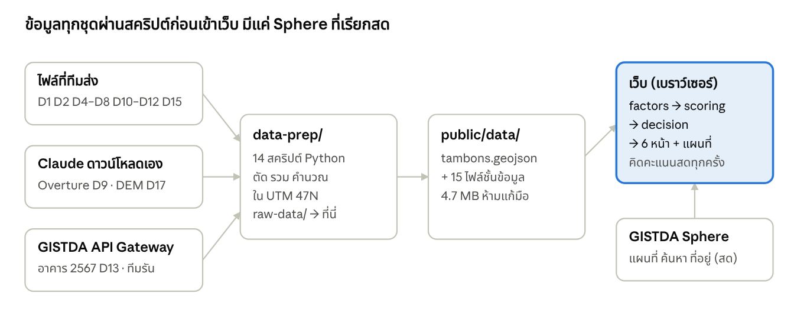
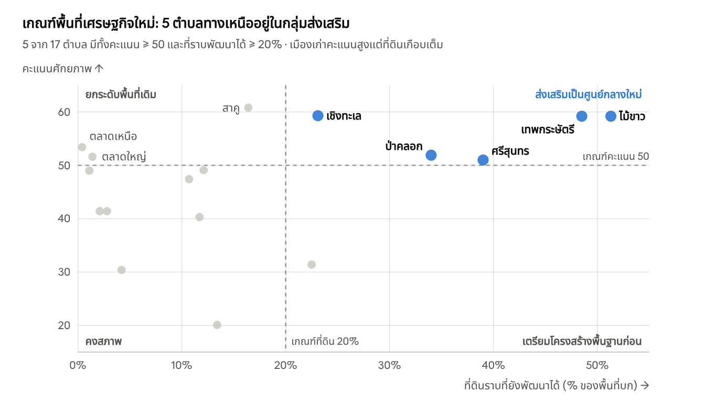

# Phuket Potential — รายงานโครงการฉบับสมบูรณ์

ข้อมูล ณ 24 ต.ค. 2569 (บ่าย) · ต้นฉบับคือไฟล์นี้ในรีโป แก้ใน PR เดียวกับงาน แล้ว Claude ซิงก์ Claude Doc ของทีมหลัง merge

## สรุปย่อ

Phuket Potential คือเว็บไซต์เรียนรู้แบบโต้ตอบ (หัวข้อ 1.2.2 ด้านการจัดการเมืองและเส้นทางระเบียงเศรษฐกิจ) ที่ให้ผู้ใช้ปรับน้ำหนักปัจจัย แล้วดูว่า 17 ตำบลของภูเก็ตควรถูก "ส่งเสริม / ยกระดับ / เตรียมโครงสร้างพื้นฐาน / คงสภาพ" อย่างไร พร้อมทดสอบว่าคำตอบทนต่อสมมติฐานที่เปลี่ยนไปแค่ไหน ณ วันที่ 24 ต.ค. 2569 โค้ดทั้งหมดอยู่ใน GitHub (PR #1–#20 merge แล้ว) แต่เว็บยังไม่ขึ้น Netlify

- **เสร็จและใช้งานได้:** แผนที่ 9 ชั้นข้อมูล, ตัวปรับน้ำหนัก 5–8 ปัจจัย, ชุดน้ำหนักสำเร็จรูป 3 ชุด, Logic Matrix 4 กลุ่ม, Stress Test 5 แบบ, หน้าภารกิจ / จัดอันดับ / วิธีคิดฯ / วิสัยทัศน์, ข้อมูลจริง 17 ชุด (D1–D17), ตัวสลับปีภาพดาวเทียม 2515–2568 + เทียบ 2 ปี + GI Basemap (ใช้ภายในทีม รออนุญาต)
- **ข้อค้นพบหลัก:** ตลาดใหญ่ได้คะแนนสูงสุด (96.6 แบบน้ำหนักเท่ากัน) แต่ประชากรตามทะเบียนในเมืองเก่าลดลง 13.9% (2559→2568) ขณะที่บ้านในสาคูเพิ่ม 76% · พื้นที่ "กำลังโต" อยู่ทางเหนือ (เชิงทะเล ไม้ขาว เทพกระษัตรี ป่าคลอก ศรีสุนทร) · 26.8% ของเกาะสูงกว่า 80 ม. ซึ่งกฎหมายห้ามก่อสร้าง · ภูเก็ตมีคนอยู่จริงมากกว่าทะเบียน เช่น กะรน 7.4 เท่า
- **สิ่งที่ค้างสำคัญ:** ขึ้นเว็บบน Netlify (ฟังก์ชันซ่อนคีย์ GISTDA เขียนแล้ว) · ทดสอบภาพ GISTDA ด้วย key จริง · Landtrendr บนเว็บ · ข้อมูลการใช้ที่ดิน 2552/2559 จาก กพด. (รออยู่) · ผังเมือง · คำตอบจาก GISTDA เรื่องสิทธิ์ใช้ภาพและ THEOS-1 · ตรวจความสูงอาคารภาคสนาม

รายงานนี้เขียนเพื่อให้ทีมอ่านแล้วอธิบายต่อกรรมการได้เอง และให้แชตใหม่ทำงานต่อได้ทันที ฉบับเดียวกันอยู่ในรีโปที่ `PROJECT_REPORT.md`

## 1. ภาพรวมโครงการ

โครงการนี้เป็นผลงานแข่งขันที่ใช้ข้อมูลจากระบบของ GISTDA วิเคราะห์จังหวัดภูเก็ต ส่งเป็นเว็บไซต์สื่อการเรียนรู้แบบโต้ตอบ

| หัวข้อ | รายละเอียด |
| --- | --- |
| โจทย์ | ด้าน 1.2.2 การจัดการเมืองและเส้นทางระเบียงเศรษฐกิจ (ทีมเลือกข้อนี้แทน 1.1.1) |
| พื้นที่ | จังหวัดภูเก็ต 3 อำเภอ 17 ตำบล พื้นที่รวม 553.5 ตร.กม. (ตามไฟล์ขอบเขตที่ใช้) |
| ประเภทผลงาน | เว็บไซต์สื่อการเรียนรู้แบบโต้ตอบ (ประเภทที่ 2) |
| เงื่อนไขหลัก | ต้องใช้บริการของ GISTDA อย่างน้อย 1 บริการ ไม่จำเป็นต้องใช้ภาพ THEOS-2 โดยตรง |
| ผู้ใช้เป้าหมาย | หน่วยงานรัฐ (วางผังเมือง) · นักลงทุน/เจ้าของกิจการ · ประชาชนทั่วไป |
| คำถามที่เว็บตอบ | ตำบลไหนควรเป็นศูนย์กลางใหม่ ตำบลไหนควรยกระดับของเดิม ตำบลไหนต้องทำถนนและบริการก่อน และตำบลไหนควรคงสภาพ |
| เทคโนโลยี | React + TypeScript + Vite, แผนที่ MapLibre บนพื้นหลัง GISTDA Sphere, ไม่มีฐานข้อมูล (ไฟล์ข้อมูลอยู่ใน `public/data/`), เตรียมข้อมูลด้วย Python |
| ที่เก็บโค้ด | GitHub `Zennsei/Phuket-Potential` · เครื่องทีม `Documents\phuket-potential\phuket-potential-v2` (remote ชื่อ `potential`) |
| สถานะ | ต้นแบบใช้งานได้ครบทุกหน้า ยังไม่เผยแพร่ออนไลน์ |

**ปัญหาที่ตั้งต้น:** เมืองเก่าภูเก็ตแออัดและที่ดินเกือบเต็ม ขณะที่การเติบโตกำลังกระจายออกไปทางเหนือและชายหาด แต่ข้อมูลที่ใช้ตัดสินใจ (อาคาร ถนน ประชากร ราคาที่ดิน การใช้ที่ดิน ภูมิประเทศ) กระจายอยู่หลายหน่วยงาน เว็บนี้รวมทุกชั้นไว้ที่เดียว ให้ผู้ใช้ตั้งหลักเกณฑ์เอง แล้วเห็นทันทีว่าคำตอบเปลี่ยนอย่างไร

**ที่มาของโครงการนี้:** ทีมทำ prototype 2 ตัวด้วย Lovable (thai-growth-atlas, landscore-analyzer) แต่ข้อมูลส่วนใหญ่เป็นข้อมูลจำลอง จึงเริ่มทำใหม่เป็น TypeScript เมื่อ 21 ต.ค. 2569 โดยใช้ข้อมูลจริงทั้งหมด เหลือเวลาราว 1 สัปดาห์กว่า ณ วันนั้น

## 2. กติกาและรายละเอียดการแข่งขัน

กติกามาจาก `details.md` ที่ทีมส่งมาวันแรก (21 ต.ค. 2569) ไฟล์ต้นฉบับอยู่ที่ทีม หัวข้อนี้สรุปส่วนที่ใช้ออกแบบเว็บ ควรเทียบกับต้นฉบับอีกครั้งก่อนส่งงาน

**สิ่งที่ผลงานต้องมี**

| ส่วน | ความหมาย | อยู่ตรงไหนในเว็บ |
| --- | --- | --- |
| Decision Rule / Logic Matrix | กฎที่บอกว่าหลักฐานแบบไหนนำไปสู่การตัดสินใจแบบไหน | หน้าภารกิจ ขั้นหลักเกณฑ์, หน้าจัดอันดับ, หน้าวิธีคิดฯ |
| Multi-Layer Evidence | หลักฐานหลายชั้นซ้อนกัน | หน้าแผนที่ 9 ชั้น + พื้นหลัง Sphere, ขั้นหลักฐาน 10 คำถาม |
| Stress Test | เปลี่ยนสมมติฐานแล้วดูว่าคำตอบยังยืนไหม | หน้าภารกิจ ขั้น Stress Test (5 สถานการณ์) |
| Mission Package | เอกสารภารกิจที่ส่งกรรมการ | **ยังไม่ได้ทำเป็นเอกสาร** ใช้รายงานนี้ DATA.md และ PROCESS.md เป็นวัตถุดิบได้ |
| Mission Arena Demo | สาธิตภารกิจให้ผู้เล่นทำจริง | หน้าภารกิจ 6 ขั้น (บทบาท → หลักฐาน → หลักเกณฑ์ → ตัดสินใจ → Stress Test → สรุป) |
| ใช้ระบบของ GISTDA | THEOS-2 หรือผลิตภัณฑ์ของ GISTDA | Sphere (แผนที่ ภาพดาวเทียม ค้นหา ที่อยู่), อาคาร GISTDA 2565 และ 2567 (API Gateway) |

**เกณฑ์การตัดสิน**

| เกณฑ์ | น้ำหนัก |
| --- | --- |
| Decision Rule / Logic Matrix | 20% |
| Mission Package | 15% |
| การใช้ผลิตภัณฑ์ THEOS-2 / GISTDA | 15% |
| คุณภาพต้นแบบ (Prototype) | 15% |
| ความเป็นไปได้ | 15% |
| ความคิดสร้างสรรค์ | 10% |
| การนำเสนอ | 10% |

**สิ่งที่ทีมบอกเพิ่ม:** ไม่จำเป็นต้องเสร็จสมบูรณ์ กรรมการอยากเห็นวิสัยทัศน์: ใช้อย่างไร พัฒนาต่ออย่างไร และนำไปใช้กับเรื่องอื่นได้อย่างไร

## 3. เป้าหมายและการตอบเกณฑ์

เป้าหมายหลักคือเว็บที่กรรมการเปิดแล้วเห็นทันทีว่าใช้ข้อมูลจริง ตัดสินใจด้วยกฎที่ตรวจสอบได้ และทดสอบความทนทานของคำตอบได้

**เป้าหมายที่ทีมตั้งไว้**

- ใช้บริการ GISTDA อย่างน้อย 1 บริการ (ตอนนี้ใช้ 3 ทาง: Sphere, อาคาร 2565, อาคาร 2567 ผ่าน API Gateway)
- รวมแผนที่ การกระจุกตัวของประชากร และการเดินทางไว้ที่เดียว
- ทำใหม่จาก prototype เป็น TypeScript เอาข้อมูลจำลองออกทั้งหมด
- เอาเว็บขึ้นออนไลน์ฟรี (ตอนนี้เลือก Netlify)
- ทีมต้องเข้าใจทุกขั้นตอนพอที่จะอธิบายกรรมการได้เอง

**แต่ละเกณฑ์ตอบด้วยอะไร และยังขาดอะไร**

| เกณฑ์ | สิ่งที่มีแล้ว | สิ่งที่ยังขาด |
| --- | --- | --- |
| Decision Rule 20% | คะแนน Min-Max ถ่วงน้ำหนัก 8 ปัจจัย + Logic Matrix 4 กลุ่ม + ความมั่นใจจาก Stress Test | เกณฑ์ผังเมือง (D16) ยังไม่ได้ใส่ |
| Mission Package 15% | หน้าภารกิจ 3 บทบาท, เอกสาร DATA.md / PROCESS.md / รายงานนี้ | เอกสาร Mission Package ฉบับส่งกรรมการ |
| ใช้ THEOS-2 / GISTDA 15% | Sphere 5 บริการ, อาคาร GISTDA 2 ปี, ทดสอบ API Gateway 3 รอบ, ภาพดาวเทียมรายปี 45 ชั้น + GI Basemap บนเว็บ (ภายในทีม) | ภาพ THEOS-2 จริง, สิทธิ์แสดงภาพ GISTDA บนเว็บสาธารณะ |
| Prototype 15% | เว็บ 6 หน้า 2 ภาษา ใช้งานได้บนคอมและมือถือ | เผยแพร่ออนไลน์ |
| ความเป็นไปได้ 15% | ข้อมูลเปิดทั้งหมด สคริปต์ทำซ้ำได้ ไม่มีค่าเซิร์ฟเวอร์ | คำตอบเรื่องสิทธิ์ใช้ข้อมูลจาก GISTDA |
| ความคิดสร้างสรรค์ 10% | ดีไซน์ "แผ่นระวาง", ถอดเลขระวางราคาที่ดิน, อาคาร 3 มิติ, เล่นทะเบียนราษฎร์รายปี, ตัวเลื่อนปีภาพดาวเทียม + เทียบ 2 ปีแบบเลื่อนเส้นแบ่ง | — |
| การนำเสนอ 10% | หน้าวิสัยทัศน์, ข้อค้นพบในหัวข้อ 20 | สไลด์และบทพูด |

## 4. ไฟล์ทั้งหมดที่ทีมส่งมา

ทีมส่งไฟล์มาราว 40 ไฟล์ (ไม่นับภาพหน้าจอ) ใช้จริง 16 ชุด คอลัมน์ "อยู่ที่" บอกไฟล์ใน `raw-data/` ที่เก็บสำเนาไว้ (ไฟล์ที่เขียนว่า "ทีมเก็บเอง" ไม่อยู่ในเครื่องทำงานของ Claude แล้ว)

| วันที่ส่ง | ไฟล์ | คืออะไร | ทำอะไรกับมัน | สถานะ | อยู่ที่ |
| --- | --- | --- | --- | --- | --- |
| 21 ต.ค. | `thai-growth-atlas-main.zip` | prototype Lovable ตัวที่ 1 | ตรวจโค้ด พบข้อมูลจำลอง | ใช้แค่แนวคิด 5 ปัจจัย × 20% | `04_lovable_prototypes.zip` |
| 21 ต.ค. | `landscore-analyzer-main.zip` | prototype Lovable ตัวที่ 2 | ตรวจ ข้อมูลสุ่มทั้งหมด | ไม่ใช้ | `04_lovable_prototypes.zip` |
| 21 ต.ค. | `README.md` (prompt Lovable) | สเปกเว็บที่ทีมต้องการ | ต้นแบบหน้าเว็บ สูตร 2 ภาษา | แนวทาง | ทีมเก็บเอง |
| 21 ต.ค. | `details.md` | กติกาและเกณฑ์การตัดสิน | ออกแบบหน้าภารกิจ | แนวทาง | ทีมเก็บเอง |
| 21 ต.ค. | `83_ภูเก็ต.zip` | อาคาร GISTDA 2565 (130,403 หลัง) | พื้นที่ จุดกึ่งกลาง นับลงตำบล กริด 500 ม. | ✅ D1 | `03_gistda_buildings_2565_83_phuket.zip` |
| 21 ต.ค. | `shapefile_Thailand…zip` | .rar 3 ไฟล์ (จังหวัด อำเภอ ตำบล) | แตกไม่ได้ | ❌ | `11_shapefile_Thailand.zip` |
| 21 ต.ค. | `Tambon.zip` | ขอบเขตตำบลทั้งประเทศ | กรองภูเก็ต รวม 46 ชิ้นเป็น 17 ตำบล | ✅ D4 | `10_Tambon.zip` |
| 21 ต.ค. | `thailand-261020_osm.pbf` | OpenStreetMap ทั้งประเทศ | ดึงถนน 22,756 เส้น สถานที่ 6,280 จุด | ✅ D6 | `12_thailand-261020_osm.pbf` |
| 21 ต.ค. | `kontur_population_TH_20231101.gpkg.gz` | ประชากรหกเหลี่ยม 2566 | ตัดภูเก็ต รวมรายตำบล | ✅ D5 | `08_kontur_population_2566.zip` |
| 21 ต.ค. | `kontur_population_TH_20220630.gpkg.gz` | ชุดเดียวกัน ปี 2565 | เก็บไว้เทียบ | 🟡 | `09_kontur_population_2565.zip` |
| 21 ต.ค. | `land_83_phuket.csv` (+ `_3`) | ราคาประเมิน 215,944 แปลง | ถอดเลขระวางเป็นตำแหน่ง | ✅ D7 | ทีมเก็บเอง |
| 21 ต.ค. | `tha_admin_boundaries` | ขอบเขตจาก HDX | ไม่ต้องใช้ | ❌ สำรอง | ทีมเก็บเอง |
| 22 ต.ค. | `Landuse_pkt.zip`, `LUCODE.zip` | การใช้ที่ดิน LDD 2563 + ตารางรหัส | ตัดตามตำบล คิดสัดส่วน | ✅ D2 | `02_ldd_landuse_2563.zip` |
| 22 ต.ค. | `data_4.csv` | สำมะโนประชากรรายอำเภอ 2533/2543/2553 | กราฟหน้าวิสัยทัศน์ | ✅ D8 | `01_team_files…zip` |
| 22 ต.ค. | `data.csv`, `data_1.csv`, `data_2.csv`, `data_3.csv` | ค่าระดับภาค + พจนานุกรม | ตรวจแล้ว | ❌ ไม่มีจังหวัด | ทีมเก็บเอง |
| 22 ต.ค. | `city_plan-Thailand.json` | แบบสำรวจ 144 ชุมชน (ไม่ใช่ผังเมือง) | ตรวจแล้ว ไม่มีพจนานุกรม | 🟡 D12 | ทีมเก็บเอง |
| 22 ต.ค. | `LOD1-Thailand.json` | สารบัญ 3D Tiles | ตรวจแล้ว ไม่มีความสูงในตัว | 🟡 (ได้ความสูงจาก API แทน) | ทีมเก็บเอง |
| 22 ต.ค. | `soilonline_LU_LV3.pdf` | ปีที่ LDD มีการใช้ที่ดิน | ใช้เลือกปีที่ยื่นขอ (2552, 2559) | ✅ อ้างอิง | ทีมเก็บเอง |
| 22 ต.ค. | `urbanplan_law.pdf` + ภาพแผนที่ dpt | กฎกระทรวงผังเมืองรวม | อ่านอ้างอิง | ⏳ D16 | ทีมเก็บเอง |
| 23 ต.ค. | `phuket_population.pdf` | รายงานสถิติจังหวัด 16 หน้า | อ่านครบ ทุกตารางเป็นระดับอำเภอ | 🟡 D10 | ทีมเก็บเอง |
| 23 ต.ค. | `tp_reg.csv/.xlsx`, `datadict_tp_reg.xlsx` | ทะเบียนประกาศผังเมือง 369 ผัง | ดึงรายการของภูเก็ต | 🟡 D11 | `01_team_files…zip` (`dpt/`) |
| 23 ต.ค. | `stat_t52/59/63/65/68.txt`, `stat_67.zip` | ทะเบียนราษฎร์รายตำบล 5 ปี | รวมตามรหัสตำบล | ✅ D15 | `01_team_files…zip` (`dopa/`) |
| 23 ต.ค. | `gistda_sample.json` | ตัวอย่างผล API อาคาร | เจอ key ใน `links` → ทีมเปลี่ยน key | ⚠️ ไม่ได้แพ็กไว้ ควรลบจากโฟลเดอร์โปรเจกต์ | รากโปรเจกต์บนเครื่องทีม |
| 23 ต.ค. | `gistda_buildings_2567_phuket.csv.gz` + progress | อาคาร 2567 พร้อมความสูง 239,992 หลัง | สรุปรายตำบลและกริด | ✅ D13 | `01_team_files…zip` (`gistda_api/`) |
| 23 ต.ค. | รายการ API ที่ key ใช้ได้ | รายชื่อบริการ API Gateway | เลือก 8 บริการมาทดสอบ | ✅ | `gistda_api/gistda_api_list.txt` |
| 23 ต.ค. | `dmcr.pdf` | ประกาศเขตคุ้มครองสิ่งแวดล้อมภูเก็ต 2567 | อ่านจากภาพ ตรวจเกณฑ์ความสูง/ความชัน | ✅ เกณฑ์ D17 | `01_team_files…zip` (`misc/`) |
| 23–24 ต.ค. | `gistda_api_probe.txt`, `gistda_api_probe2.txt`, probe3 `report.txt` + ภาพ 20 ภาพ | ผลทดสอบ API 3 รอบ | สรุปใน DATA.md และหัวข้อ 11 | ✅ | `gistda_api/`, `probe3_images/` (ลบ key ออกแล้ว) |
| 21–24 ต.ค. | ภาพหน้าจอราว 20 ภาพ | F12 network, หน้าเว็บหน่วยงาน, ผล curl | ใช้หา endpoint และตรวจผล | — | `screenshots_sent_to_claude/` |

ไฟล์จาก dinonline (การใช้ที่ดินที่ได้มาทีหลัง) เหมือน `Landuse_pkt.zip` ทุกไบต์ ส่วนการใช้ที่ดิน 2552/2559 ที่ยื่นขอผ่าน dinonline เมื่อ 22 ต.ค. 23:01 **ยังไม่ได้รับ** (ตามที่ทีมแจ้ง 24 ต.ค.)

## 5. การตัดสินใจทั้งหมด

การตัดสินใจ 40 เรื่อง เรียงตามเวลา "ทีม" = ทีมตัดสินหรืออนุมัติ, "Claude" = Claude เสนอและทีมไม่คัดค้าน (ทีมควรทบทวนข้อเหล่านี้)

| วันที่ | เรื่อง | ตัดสินว่า | เหตุผล | โดย |
| --- | --- | --- | --- | --- |
| 21 ต.ค. | โจทย์ | ด้าน 1.2.2 ไม่ใช่ 1.1.1 | ตรงกับข้อมูลเมืองและการเดินทาง | ทีม |
| 21 ต.ค. | ผลงาน | เว็บไซต์เรียนรู้แบบโต้ตอบ | ประเภทที่ 2 ของการแข่งขัน | ทีม |
| 21 ต.ค. | prototype | ทำใหม่เป็น TypeScript ไม่ใช้โค้ด Lovable | ข้อมูลจำลองเกือบทั้งหมด | ทีม |
| 21 ต.ค. | ฐานข้อมูล | ไม่ใช้ ใช้ไฟล์ GeoJSON/CSV ใน `public/data/` | ข้อมูลเล็ก (4.7 MB) เป็นเว็บสถิตได้ ฟรี ไม่มีเซิร์ฟเวอร์ | Claude |
| 21 ต.ค. | หน่วยวิเคราะห์ | 17 ตำบล + กริดย่อยสำหรับดู | ตำบลคือหน่วยที่รัฐใช้ตัดสินใจ | Claude |
| 21 ต.ค. | สูตรคะแนน | Min-Max 0–100 ถ่วงน้ำหนัก | เข้าใจง่าย คำนวณซ้ำได้ ต่อยอดจาก prototype 5 × 20% | Claude |
| 21 ต.ค. | ประชากร | ใช้ Kontur 2566 ไม่ใช้ส่วนต่าง 2565→2566 เป็นการเติบโต | ส่วนต่างมาจากการปรับแบบจำลอง | Claude |
| 21 ต.ค. | ระยะถนน | ใช้ค่ากลาง (median) ไม่ใช้ค่าเฉลี่ย | อาคารบนเกาะเล็กดึงค่าเฉลี่ยผิด | Claude |
| 21 ต.ค. | เลขแผ่นระวาง | เรียงทีละแถวจากมุมบนซ้าย | ทดสอบ 4 แบบ แบบนี้ตกบนเกาะ 94.3% | Claude |
| 22 ต.ค. | การแก้ไฟล์ | ห้ามเขียนทับต้นฉบับ ทำในโฟลเดอร์ใหม่ (v2, v3) และต่อมาใช้ branch + PR | ย้อนกลับได้ | ทีม |
| 22 ต.ค. | ที่เก็บโค้ด | GitHub `Zennsei/Phuket-Potential`, remote ชื่อ `potential` | ทำงานร่วมกันและตรวจทุกการเปลี่ยนแปลง | ทีม |
| 22 ต.ค. | ดีไซน์ | แนวคิด "แผ่นระวาง" (กรอบพิกัดรอบแผนที่) | เชื่อมกับการถอดเลขระวางจริง | Claude, ทีม merge #3 |
| 22 ต.ค. | ที่ดินพัฒนาได้ | = เกษตร + เบ็ดเตล็ด (ไม่นับป่า) | ป่าส่วนใหญ่เป็นพื้นที่อนุรักษ์ | Claude |
| 22 ต.ค. | การใช้ที่ดินย้อนหลัง | ยื่นขอ LDD ปี 2552 และ 2559 | เทียบการเปลี่ยนแปลง 3 ช่วง | ทีม |
| 23 ต.ค. | ทะเบียนข้อมูล | ทำ `DATA.md` (D1–D17) และสถานะข้อมูลในเว็บ | ทีมขอให้บันทึกทุกอย่างพร้อมปี | ทีม |
| 23 ต.ค. | key GISTDA | ใส่ใน `.env` ชื่อ `GISTDA_API_KEY` ใช้แค่สคริปต์บนเครื่อง | เครดิตจำกัด ไม่ให้หลุดไปเบราว์เซอร์ | ทีม |
| 23 ต.ค. | ผังเมือง | ไม่ดึงจากเซิร์ฟเวอร์กรมโยธาฯ ที่ตอบ `Token Required` | ไม่มีสิทธิ์ จะขอไฟล์หรือวาดตามประกาศ | ทีม + Claude |
| 23 ต.ค. | ปัจจัยจากทะเบียน | ใช้การเติบโตของ "บ้าน" ไม่ใช่ "คน" | คนในเมืองเก่าลดตามทะเบียนแม้คนอยู่จริงไม่ลด | Claude |
| 23 ต.ค. | Logic Matrix | คะแนน × ที่ดินพัฒนาได้ เกณฑ์ 50 และ 20% ปรับได้ | ตอบเกณฑ์ 20% ตรงที่สุด | Claude, ทีม merge #6 |
| 23 ต.ค. | เวลาเดินทาง | เลือกปลายทางได้ 5 แบบ | ผู้ใช้แต่ละกลุ่มสนใจปลายทางต่างกัน | Claude, ทีม merge #7 |
| 23 ต.ค. | อาคาร 2567 | เป็นตัวเลือก ค่าตั้งต้นยังใช้ 2565 และห้ามลบกันหา "อาคารใหม่" | วิธีเก็บต่างกัน | Claude |
| 23 ต.ค. | แผงซ้ายขวา | พับได้ทุกหัวข้อ + แบบง่าย/ขั้นสูง | ทีมเห็นว่าแผงยาวเกิน | ทีม |
| 23 ต.ค. | ข้อมูลรายปี | เลือกปีได้เฉพาะการดู ไม่เปลี่ยนคะแนน | ไม่ให้ปีปนกันในคะแนน | ทีมถาม, Claude เสนอ |
| 23 ต.ค. | ที่เก็บเว็บ | Netlify (เดิมคิด Vercel) | ตั้งค่าได้ด้วย `netlify.toml` และมี Function ซ่อน key ได้ | ทีม |
| 23 ต.ค. | ภูมิประเทศ | ใช้ Copernicus DEM ตัดที่สูง 80 ม.+ และชันเกิน 20% ออกจากที่ดินพัฒนาได้ (ค่าตั้งต้น) | ทีมเสนอว่าภูเขาสร้างยาก ตรงกับประกาศ 2567 | ทีม + Claude |
| 23 ต.ค. | Hillshade | ไม่ใช้คำนวณ | เป็นภาพเงา ไม่มีค่าความสูง | Claude, ทีมยืนยัน 24 ต.ค. |
| 24 ต.ค. | ภาพดาวเทียมรายปี | ใส่เว็บให้สลับปีได้ | ภาพ 1990–2567 คุณภาพดี | ทีม |
| 24 ต.ค. | GI Basemap | ใส่เป็นตัวสลับเทียบกับ Sphere | ทีมอยากเทียบเอง | ทีม |
| 24 ต.ค. | Landtrendr / Land collections | ใส่ถ้าทำได้ / หาทางเข้าถึงต่อ | น่าสนใจ ใช้ได้หลายทาง | ทีม |
| 24 ต.ค. | PLEIADES | ตัดออก | 21 คอลเลกชันไม่ครอบคลุมภูเก็ตเลย | ตามผลทดสอบ |
| 24 ต.ค. | ไฟล์ดิบ | เก็บใน `raw-data/` บนเครื่องทีม ไม่ commit | ไฟล์ใหญ่และบางไฟล์เผยแพร่ไม่ได้ | ทีม |
| 24 ต.ค. | ตัวกลางซ่อน key GISTDA | `/gistda/*` โค้ดเดียวกันทั้งตอน `npm run dev` และ Netlify Function ยอมเฉพาะภาพรายปีและ GI Basemap ในกรอบภูเก็ต | key ไม่ไปถึงเบราว์เซอร์ และคนอื่นใช้เครดิตทีมขอภาพที่อื่นไม่ได้ | Claude, ทีม merge #16 |
| 24 ต.ค. | ภาพ GISTDA บนเว็บ | ซ่อนเมนูไว้ เปิดเมื่อตั้ง `VITE_GISTDA_IMAGERY=1` จนกว่า GISTDA จะอนุญาต | ภาพระบุ "Copyrighted by GISTDA, Fees: Yes" | Claude, ทีม merge #16 |
| 24 ต.ค. | วิธีอัปเดตรายงานนี้ | แก้ `PROJECT_REPORT.md` ใน PR เดียวกับงาน Claude ซิงก์ Claude Doc หลังทีม merge | มีต้นฉบับเดียว ทีมตรวจทุกการแก้ผ่าน PR | ทีมเสนอ, Claude เห็นด้วย |
| 24 ต.ค. | อาคาร 3 มิติรายหลัง | ดึงสดจาก API ผ่านตัวกลาง เป็นแผ่น 600 ม. เฉพาะซูม 15+ ใช้ภายในทีม | ไฟล์ D13 ไม่มีรูปอาคาร, ทั้งเกาะใหญ่เกินจะใส่ในรีโป, แผนที่ทั่วไปก็แสดงตึก 3 มิติเฉพาะตอนซูมใกล้ | ทีมเสนอดึงจาก API, Claude ออกแบบ |
| 24 ต.ค. | อาคาร 3 มิติเป็นแผ่นเวกเตอร์ + ลดรายละเอียด | ตัวกลางส่งแผ่น MVT แทน GeoJSON · ซูม 15 เก็บเฉพาะหลัง ≥ 100 ตร.ม. หรือ ≥ 12 ม. · ซูม 16 ทุกหลัง | ทีมเห็นว่าหน่วงตอนโหลดเยอะ และแผนที่ทั่วไปลดรายละเอียดตอนซูมออก | ทีมเสนอ, Claude ออกแบบ |
| 24 ต.ค. | แผ่น Sphere ถนนที่ว่าง | หยุดที่ระดับ 17 + แผ่นที่แทบว่างใช้ส่วนของแผ่นระดับบนขยายแทน (`src/sphereFix.ts`) | ทีมเจอแผ่นขาว/ไม่มีถนนเป็นหย่อมๆ (เทพกระษัตรี ป่าคลอก ไม้ขาว) | ทีมแจ้ง, Claude ออกแบบ |
| 24 ต.ค. | ชั้นถนนและซอยทุกประเภท | แผ่นเวกเตอร์จาก OSM ที่มีอยู่แล้ว เปิดไว้ตั้งต้น ขึ้นเมื่อซูม 14+ | ทีมอยากเห็นซอยเข้าหมู่บ้าน · Overture ถนนมาจาก OSM เป็นหลัก | ทีมขอ, Claude ทำ |
| 24 ต.ค. | Overture ในชั้น 3 มิติ | เพิ่มเป็นตัวเลือก (เปิดได้ทุกคน) + เส้นขอบซ้อนเทียบตำแหน่ง · แผ่นเก็บในรีโป 9.6 MB | ทีมอยากเช็กว่าอาคาร GISTDA อยู่ถูกที่ · Overture เป็นข้อมูลเปิด | ทีมขอ, Claude ทำ |
| 24 ต.ค. | ผลทดสอบ API ที่ไม่พบข้อมูลภูเก็ต | แสดงบนเว็บด้วยสถานะ "ทดสอบแล้ว ไม่มีข้อมูลภูเก็ต" (หน้าวิสัยทัศน์ + หน้าวิธีคิดฯ) และเพิ่มข้อจำกัดว่าคะแนนยังไม่รวมความเสี่ยงภัยพิบัติ | บอกกรรมการว่าทีมตรวจแล้ว และอธิบายว่าทำไมไม่มีปัจจัยน้ำท่วม | Claude |

## 6. กฎและความต้องการที่ทีมกำหนด

กฎมาจาก 3 ที่: สิ่งที่ทีมบอกในแชต, `AGENTS.md` ในรีโป และเงื่อนไขของแหล่งข้อมูล ทุกคน (และ AI ทุกตัว) ที่แก้โปรเจกต์ต้องทำตาม

**วิธีทำงานที่ทีมขอ**

- ตอบเป็นภาษาไทย (ทีมพิมพ์อังกฤษได้สะดวกกว่า แต่อ่านภาษาไทยง่ายกว่า)
- ห้ามเขียนทับไฟล์หรือโฟลเดอร์เดิม งานที่แก้ต้องอยู่ที่ใหม่ ตอนนี้ใช้ branch + Pull Request ทีม merge เอง
- ใช้ package ให้น้อย ปลอดภัย และบอกทีมก่อนเพิ่ม
- บันทึกข้อมูลทุกชุดพร้อมปีและที่มา ทั้งใน markdown และบนเว็บแบบย่อ
- ทีมใช้ Codex อีกตัวเป็นผู้ตรวจ ข้อสังเกตของ Codex ถูกนำมาแก้ใน PR #10

**AGENTS.md (สรุป 15 ข้อ + 9.1, 9.2)**

| หมวด | กฎ |
| --- | --- |
| Package | 1) ใช้น้อยที่สุด 2) บอกทีมก่อนเพิ่ม 3) ใช้แต่ตัวที่มีคนดูแลและออกมาแล้ว ≥ 2 สัปดาห์ 4) ล็อกเวอร์ชันตรงตัว + commit lock file 5) ไม่รันสคริปต์ติดตั้ง 6) `npm audit` ต้องได้ 0 |
| ความลับ | 7) ห้ามใส่ key ในโค้ด ใช้ `.env` 8) จำกัดโดเมนของ key Sphere 9) ห้ามดึงข้อมูล Sphere เก็บเป็นจำนวนมาก 9.1) key GISTDA ชื่อ `GISTDA_API_KEY` ไม่ส่งไปเบราว์เซอร์ 9.2) ห้ามแปะ key ในแชต issue PR ภาพหน้าจอ หรือไฟล์ที่ commit หลุดแล้วต้องขอใหม่ 9.3) ภาพจาก API Gateway ใช้ภายในทีม ห้ามตั้ง `VITE_GISTDA_IMAGERY=1` บน Netlify จนกว่าจะได้รับอนุญาต |
| ข้อมูล | 10) ทุกชั้นบอกแหล่งและวันที่ 11) ห้ามปนข้อมูลจำลอง 12) ห้ามเขียนว่าอาคาร 2565 มาจาก THEOS-2 13) ไฟล์ใน `public/data/` สร้างจากสคริปต์เท่านั้น |
| โค้ด | 14) ห้ามเขียนทับต้นฉบับ 15) `npm run build` ต้องผ่าน |

**เงื่อนไขจากแหล่งข้อมูล**

- Sphere: ใช้แบบไม่แสวงหากำไร ห้ามโหลดภาพหรือผลค้นหาจำนวนมาก ต้องแสดง "© GISTDA sphere · © OpenStreetMap contributors"
- ภาพจาก GISTDA API (ภาพดาวเทียมรายปี ฯลฯ): ระบุ "Copyrighted by GISTDA, Fees: Yes" ใช้ประเมินภายในทีมเท่านั้น ห้าม commit หรือเผยแพร่จนกว่าจะได้รับอนุญาต
- OpenStreetMap และ Overture: ODbL ต้องให้เครดิต
- Copernicus DEM: ต้องแสดงเครดิต DLR / Airbus / ESA

## 7. บัญชีและคีย์

โปรเจกต์ใช้ key 2 ตัว เก็บในไฟล์ `.env` บนเครื่องทีมเท่านั้น (ไม่ถูก commit) รายงานนี้ไม่มีค่า key จริง

| บัญชี / key | ชื่อใน `.env` | ใครเห็นได้ | ใช้ทำอะไร | สิ่งที่ต้องทำ |
| --- | --- | --- | --- | --- |
| GISTDA Sphere | `VITE_SPHERE_KEY` | ทุกคนที่เปิดเว็บ (อยู่ในไฟล์ JS ที่ build) | แผนที่พื้นหลัง ภาพดาวเทียม ค้นหา ที่อยู่ สถานที่ใกล้เคียง | จำกัดโดเมนในหน้าจัดการ key หลังได้โดเมน Netlify |
| GISTDA API Gateway | `GISTDA_API_KEY` | เฉพาะเครื่องทีม (ไม่มี `VITE_` จึงไม่เข้าเบราว์เซอร์) | สคริปต์ดึงอาคาร 2567, สคริปต์ทดสอบ 3 รอบ, ตัวกลาง `/gistda/*` ตอน `npm run dev` (ภาพรายปี, GI Basemap) | ตั้งใน Netlify เมื่อได้รับอนุญาตให้แสดงภาพ (Function `netlify/functions/gistda.mjs` เขียนแล้ว) |
| GitHub | — | — | รีโป `Zennsei/Phuket-Potential` ทีมเป็นเจ้าของ Claude เปิด PR ผ่าน GitHub App | — |
| Netlify | — | — | **ยังไม่ได้สมัคร/เชื่อม** | ดูหัวข้อ 19 |
| LDD dinonline | — | — | ยื่นคำร้องข้อมูลการใช้ที่ดิน | รอผล |

**เหตุการณ์ key หลุด (23 ต.ค.):** ผลลัพธ์จาก API Gateway ใส่ key ไว้ในลิงก์ `links` (เช่น `api_key=…`) ทีมแนบ `gistda_sample.json` มาในแชต key จึงหลุด ทีมเปลี่ยน key ทันที ตั้งแต่นั้นทุกสคริปต์ลบ `links` และแทน key ด้วย `<removed>` ก่อนเขียนไฟล์ ไฟล์ `gistda_sample.json` ยังอยู่ที่รากโฟลเดอร์โปรเจกต์บนเครื่องทีม (ไม่ถูก commit) ควรลบทิ้ง

**เหตุที่ key Sphere เห็นได้:** เว็บสถิตไม่มีเซิร์ฟเวอร์ เบราว์เซอร์ต้องเรียก Sphere เอง key จึงต้องอยู่ในหน้าเว็บ วิธีป้องกันที่ Sphere ออกแบบไว้คือการจำกัดโดเมนที่ใช้ key ได้

## 8. ข้อมูลทุกชุด (D1–D17)

ใช้ในเว็บแล้ว 11 ชุด ได้แต่ยังไม่ใช้ 4 ชุด รอ 2 ชุด รายละเอียดเต็ม (ไฟล์ต้นทาง สคริปต์ คอลัมน์ ข้อจำกัด เครดิต) อยู่ใน `DATA.md`

| # | ข้อมูล | แหล่ง | ปีของข้อมูล | ได้มาอย่างไร | สถานะ | ใช้ทำอะไร |
| --- | --- | --- | --- | --- | --- | --- |
| D1 | รูปแปลงอาคาร 130,403 หลัง | **GISTDA** (แจกต่อผ่าน thaivaluer.com) | 2565 | ทีมส่ง | ✅ ใช้ | ปัจจัยอาคาร (ค่าตั้งต้น), กริด 500 ม., ต้นทางของระยะถนนและเวลาเดินทาง |
| D2 | การใช้ที่ดิน | กรมพัฒนาที่ดิน (แปลจาก **THAICHOTE** + Landsat 8) | 2563 | ทีมส่ง | ✅ ใช้ | ที่ดินพัฒนาได้, ชั้นการใช้ที่ดิน |
| D3 | แผนที่ ภาพดาวเทียม ค้นหา ที่อยู่ | **GISTDA Sphere** | ออนไลน์ | เรียกสด | ✅ ใช้ | พื้นหลัง, ค้นหา, ดูรอบจุด |
| D4 | ขอบเขตตำบล | ไฟล์ของทีม (ไม่ทราบต้นทาง) | ไฟล์ปี 2566 | ทีมส่ง | ✅ ใช้ | หน่วยวิเคราะห์ 17 ตำบล |
| D5 | ประชากรแบบจำลอง | Kontur ผ่าน HDX | 2566 | ทีมส่ง | ✅ ใช้ | ปัจจัยประชากร, ชั้นหกเหลี่ยม |
| D6 | ถนนและสถานที่ | OpenStreetMap (Geofabrik) | 20 ต.ค. 2569 | ทีมส่ง | ✅ ใช้ | ปัจจัยถนน บริการ เวลาเดินทาง |
| D7 | ราคาประเมินที่ดิน 215,944 แปลง | กรมธนารักษ์ (data.go.th) | รอบ 2566–2569 | ทีมส่ง | ✅ ใช้ | ปัจจัยราคาที่ดิน, กริด 1 กม. |
| D8 | สำมะโนประชากรรายอำเภอ | สำนักงานสถิติแห่งชาติ (data.go.th) | 2533, 2543, 2553 | ทีมส่ง | ✅ ใช้ | กราฟหน้าวิสัยทัศน์ |
| D9 | อาคาร Overture 219,565 หลัง | Overture Maps (S3 สาธารณะ) | release 2026-09-23.1 | Claude ดาวน์โหลด | 🟡 ใช้ตรวจ | เทียบความครบของ D1, ตรวจความสูง D13 |
| D10 | รายงานสถิติจังหวัด | กรมการปกครอง | 2558–2562 | ทีมส่ง | 🟡 | เล่าแนวโน้มระดับอำเภอ |
| D11 | ทะเบียนประกาศผังเมือง | กรมโยธาธิการและผังเมือง | 2526–2566 | ทีมส่ง | 🟡 | อ้างว่าผังจังหวัดภูเก็ตประกาศ 7 ก.ค. 2554 แก้ล่าสุด 16 ม.ค. 2556 |
| D12 | แบบสำรวจรายชุมชน ("city\_plan") | data.go.th (gis-03) | ไม่ทราบ | ทีมส่ง | 🟡 ใช้ไม่ได้ | ต้องมีพจนานุกรมคำถาม q01–q42 |
| D13 | อาคารพร้อมความสูง 239,992 หลัง | **GISTDA API Gateway** | 2567 (อัปเดต ส.ค. 2569) | ทีมรันสคริปต์ดึง | ✅ ใช้ | ตัวเลือกพื้นที่ใช้สอย, ชั้นอาคาร 3 มิติ |
| D14 | การใช้ที่ดิน 2552, 2559 | กรมพัฒนาที่ดิน (dinonline) | 2552, 2559 | ยื่นคำร้อง 22 ต.ค. | ⏳ รอ | เทียบการเปลี่ยนแปลงกับ 2563 |
| D15 | ประชากรและบ้านตามทะเบียนรายตำบล | กรมการปกครอง (stat.bora.dopa.go.th) | 2552, 2559, 2563, 2565, 2568 | ทีมส่ง | ✅ ใช้ | ปัจจัยการเติบโตของบ้าน, Stress Test, หมายเหตุประชากรแฝง, ดูรายปี |
| D16 | ผังเมืองรวมภูเก็ต (โซนสี) | กรมโยธาธิการและผังเมือง | — | เซิร์ฟเวอร์ต้องมีสิทธิ์ | ⏳ ต้องขอไฟล์หรือวาดเอง | ตัดพื้นที่ที่ผังเมืองห้ามพัฒนา |
| D17 | ความสูงและความชัน | Copernicus DEM GLO-30 (ESA/EU, AWS) | บันทึก 2554–2558 | Claude ดาวน์โหลด | ✅ ใช้ | ตัดที่สูง/ชันออกจากที่ดินพัฒนาได้, ชั้นภูเขา |

**บริการ GISTDA ที่ทดสอบแต่ยังไม่ได้ใส่เว็บ** (ผลเต็มในหัวข้อ 11): ภาพดาวเทียมรายปี 1972–2025 (WMS 45 ชั้น), GI Basemap, Landtrendr, Hillshade, Land feature collections, น้ำท่วมซ้ำซาก, THEOS-1, PLEIADES, UHI

**ตรวจแล้วไม่ใช้:** ข้อมูลจำลองใน prototype, ชั้น "THEOS-2 AI Layer" ปลอม, ภาพแรก THEOS-2 (มีแค่กรุงเทพฯ), ข้อมูลระดับภาค, ไฟล์ .rar, landx.gistda.or.th (เรียกจากเครื่องทำงานไม่ได้ 502)

## 9. สิ่งที่ Claude ดาวน์โหลดหรือเปิดดูเอง

Claude ทำงานในเครื่อง cloud ที่เข้าอินเทอร์เน็ตได้เฉพาะโดเมนที่ทีมเปิดให้ ดาวน์โหลดข้อมูลเอง 2 ชุด นอกนั้นเป็นการเปิดดูหน้าเว็บและทดสอบบริการ

**ดาวน์โหลดเอง (อยู่ใน `raw-data/` แล้ว)**

| ข้อมูล | จาก | วันที่ | ไฟล์ใน raw-data |
| --- | --- | --- | --- |
| อาคาร Overture (D9) | S3 สาธารณะ `overturemaps-us-west-2` อ่าน GeoParquet ตรงด้วย pyarrow | 22 ต.ค. | `06_overture_buildings_2026-09-23.zip` |
| Copernicus DEM 2 แผ่น (D17) | `copernicus-dem-30m.s3.amazonaws.com` (ทีมเปิดโดเมนให้) | 23 ต.ค. | `07_copernicus_dem_glo30.zip` |

**ผลผลิตระหว่างทางที่ Claude สร้าง** (ไม่อยู่ในรีโป) รวมไว้ใน `05_intermediate_outputs.zip`: ถนนและสถานที่ที่ตัดจาก OSM, ผล `data_prep.py` รุ่น v1 และ v3, หน้าตรวจข้อมูล `phuket-data-check.html`

**เปิดดูและทดสอบ (ไม่ได้เก็บไฟล์)**

| แหล่ง | ทำอะไร | ผล |
| --- | --- | --- |
| Sphere map library `api.sphere.gistda.or.th/map/` | อ่านโค้ดหาที่อยู่ tile และ API | ได้ 5 endpoint ที่ใช้อยู่ (`sphere_hybrid` ไม่มีจริง) |
| sphere.gistda.or.th/terms | อ่านเงื่อนไข | ไม่แสวงหากำไร ห้ามโหลดจำนวนมาก ลิงก์ API terms เสีย |
| GISTDA API Gateway (ไม่ใช้ key) | เรียกดูวิธีส่ง key | header `API-Key`, CORS `*` |
| data.go.th | catalog ราคาประเมิน, สำมะโน, gis-03 | ยืนยันปีและที่มาของ D7 D8 D12 |
| lddcatalog.ldd.go.th | หน้าชุด ldd\_21\_01 | ยืนยันวิธีทำ D2 (THAICHOTE + Landsat 8, ความถูกต้อง 86.59%) |
| landuseplan.dpt.go.th, onedptgis.dpt.go.th | ตามที่มาของแผนที่ผังเมือง (ทีมเปิดโดเมนให้) | ArcGIS `PLLU_VIEW` ชั้น 5 ต้องมี token → ไม่ดึง |
| stat.bora.dopa.go.th | หาหน้าดาวน์โหลดระดับตำบล | ทีมดาวน์โหลดตามลิงก์ |
| theos2firstimage.gistda.or.th | ดูพื้นที่ครอบคลุม | มีแค่กรุงเทพฯ |
| landx.gistda.or.th | ลองเรียก | 502 จากเครื่องทำงาน |
| Geofabrik | ลองดาวน์โหลด OSM | การเชื่อมต่อถูกตัด ใช้ไฟล์ของทีมแทน |
| ประกาศเขตคุ้มครองฯ ภูเก็ต 2560 | ค้นเกณฑ์ความสูง/ความชัน | เกิน 80 ม. ห้ามก่อสร้าง, ชัน 20–35% บ้านเดี่ยว (ต่อมาตรวจกับฉบับ 2567 ที่ทีมส่ง) |
| awagad.gistda.or.th | ดูทางซื้อภาพ THEOS-2 | ยังไม่ทราบราคา |

บริการที่ต้องใช้ key GISTDA ไม่ได้เรียกจากเครื่อง Claude เลย ทีมรันสคริปต์บนเครื่องตัวเองแล้วส่งผลที่ลบ key แล้วมา

## 10. ไลบรารีและเครื่องมือ

เว็บใช้ package ภายนอกแค่ 3 ตัว (react, react-dom, maplibre-gl) ทุกอย่างที่เหลือเขียนเอง ส่วนการเตรียมข้อมูลใช้ Python บนเครื่อง cloud ของ Claude

**เว็บไซต์ (npm, ล็อกเวอร์ชันตรงตัว, `npm audit` = 0)**

| package | เวอร์ชัน | ใช้ทำอะไร | เหตุผลที่เลือก |
| --- | --- | --- | --- |
| react, react-dom | 19.3.0 | สร้างหน้าเว็บ | มาตรฐาน prototype เดิมก็ใช้ |
| maplibre-gl | 6.11.2 | แผนที่ | ฟรี และ Sphere ก็สร้างบน MapLibre |
| vite | 8.3.3 | build เว็บ | 8.3.0–8.3.2 มีช่องโหว่ |
| typescript | 6.0.3 | ตรวจชนิดข้อมูล | ทีมขอ TypeScript |
| @vitejs/plugin-react | 6.1.1 | ให้ vite อ่าน React | — |
| @types/react, @types/react-dom, @types/geojson | ตาม package.json | ชนิดข้อมูล | — |

ฟอนต์ Chakra Petch และ Noto Sans Thai โหลดจาก Google Fonts ส่วนกราฟ กรอบพิกัด ตัวเลือกสี การดาวน์โหลด CSV/JSON เขียนเองทั้งหมด (ไม่เพิ่ม package)

**เตรียมข้อมูล (Python 3.13)**

| ไลบรารี | เวอร์ชัน | ใช้ใน |
| --- | --- | --- |
| geopandas, shapely, pyproj, pyogrio | 1.2.0, 2.2.0, 3.8.0, 0.13.0 | อ่าน shapefile ตัดซ้อน แปลงพิกัด UTM 47N |
| osmium (pyosmium) | — | อ่านไฟล์ OSM .pbf |
| numpy, pandas | 2.5.3, 3.0.5 | คำนวณตาราง |
| scipy | 1.18.1 | `cKDTree` หาจุดใกล้สุด, กราฟเส้นทาง Dijkstra |
| pyarrow | 26.0.0 | อ่าน GeoParquet ของ Overture จาก S3 |
| rasterio | 1.4.3 | อ่าน DEM (ติดตั้งเพิ่ม 23 ต.ค. ใช้เฉพาะ `terrain_prep.py`) |
| Pillow | 12.3.0 | สร้างภาพ `terrain.png` |
| Python มาตรฐาน (urllib, json, csv) | — | สคริปต์ที่ทีมรันเอง (`gistda_*`, `dopa_prep.py`) ไม่ต้องติดตั้งอะไรเพิ่ม |

**เครื่องมืออื่น**

- Node.js 22 + npm 10: build และทดสอบเว็บ (`npm run build`, `vite preview`)
- Playwright 1.56 + Chromium: เปิดเว็บจริง ถ่ายภาพหน้าจอคอม 1440 px และมือถือ 390 px กดปุ่มและอ่านค่าในตาราง
- git + GitHub CLI (`gh`): สร้าง branch และ Pull Request
- LibreOffice / ตัวอ่าน PDF: เปิด .xls .xlsx .doc และแปลงหน้า PDF เป็นภาพ (ใช้กับ `dmcr.pdf` ที่ถอดข้อความไม่ได้)
- เครื่องมือของ Claude: WebSearch/WebFetch (ค้นและอ่านหน้าเว็บ), Claude Docs (รายงานนี้), สะพานไปเครื่องทีม (ส่งไฟล์เข้า `raw-data/`)

## 11. งานค้นคว้า

งานค้นคว้าที่ส่งผลต่อเว็บมากที่สุดมี 3 เรื่อง: บริการ GISTDA ที่ใช้ได้จริง, กฎหมายที่ดินภูเขาของภูเก็ต และที่มาของข้อมูลแต่ละชุด

### 11.1 ผลทดสอบ GISTDA API Gateway 3 รอบ (23–24 ต.ค.)

ทีมรันสคริปต์ `gistda_api_probe.py`, `_probe2.py`, `_probe3.py` บนเครื่องตัวเอง แต่ละรอบใช้ประมาณ 15, 25, 80 คำขอ · รอบ 4 (`_probe4.py` ราว 25 คำขอ) เขียนแล้วใน #21 รอทีมรัน

| บริการ | path | ผลสุดท้าย | ตัดสินว่า |
| --- | --- | --- | --- |
| อาคารพร้อมความสูง | `/features/thailand-buildings-footprint/items` | ✅ 243,747 หลังในกรอบ ดึงครบใน 244 คำขอ | ใช้แล้ว (D13) |
| ภาพดาวเทียมรายปี | `/gfms/service/` (WMS/WMTS) | ✅ 45 ชั้น: 1972, 1973, 1975, 1976, 1979, 1987–2011, 2013–2025 + `thailand_2563_2564_2m`, `thailand_2567_2m` ได้ภาพภูเก็ตทุกปีที่ขอ 12 ปี | **ใส่เว็บแล้ว** ตัวสลับปี + เทียบ 2 ปี (#16, ใช้ภายในทีมจนกว่าจะได้สิทธิ์) |
| GI Basemap | `/tiles/basemap_latest/{z}/{x}/{y}.png` | ✅ เป็นภาพดาวเทียม z12 เบลอ z13 คมชัด | **ใส่เว็บแล้ว** สลับเทียบกับ Sphere (#16, ใช้ภายในทีม) |
| Landtrendr-all | `/maps/coverage/landtrendr-all/{z}/{x}/{y}` | ✅ PNG สีตามปีที่พื้นที่เปลี่ยน | **ใส่ถ้าทำได้** ต้องหาคำอธิบายสี |
| Hillshade | `/tiles/public/hillshade` | ✅ ภาพเงา webp ซูมถึง 12 | ไม่ใช้ (มี DEM แล้ว) |
| Land feature collections | `/features/land/collections` | ✅ 117,613 ชุด มี "slop", "Administrator Tambon", "Population" แต่ `…/{id}/items` ได้ 404 | หา path ที่ถูกต่อ |
| น้ำท่วมซ้ำซาก | `/gi-service/v1.1/disasters/flood-recurrence` | ตาราง 33 จุด: "not found" 30 จุด, "Out of area" 3 จุดในทะเล | ไม่มีพื้นที่น้ำท่วมซ้ำซากบันทึกในภูเก็ต (ใช้เป็นข้อค้นพบ) |
| PLEIADES | `/stac/PLEIADES` | 21 คอลเลกชัน ไม่มีภูเก็ต | ตัดออก |
| THEOS-1 | `/stac/theos1/…` | หน้าแรกได้ ลิงก์ย่อยชี้ไป `nsdc.gistda.or.th` (401) collection/items 404 | ถาม GISTDA |
| UHI เกาะความร้อน | `/tiles/vector/uhi/…` | 204 ไม่มีข้อมูลที่ภูเก็ต | ไม่ใช้ |
| น้ำท่วม 1 วัน | `/gi-service/v1.1/disasters/flood-extent-1day` | 404 | ไม่ใช้ |
| LOD1 3D Tiles | `/3d-tiles/thailand-lod/tileset.json` | เข้าได้ | ไม่จำเป็น มีความสูงจาก D13 แล้ว |

**คุณภาพภาพดาวเทียมรายปีที่เห็น (ทั้งเกาะ):** 1972 มีเส้นริ้วและเมฆ · 1975 เมฆมาก · 1990–2025 และ 2563 (2 ม.) สะอาด · 2567 (2 ม.) มีรอยต่อภาพและเมฆเมื่อดูทั้งเกาะ แต่ซูมใกล้คมชัดมาก · ภาพใกล้เมืองเก่าปี 2000 และ 2010 เบลอเพราะความละเอียดภาพเก่าต่ำ

### 11.2 กฎหมายพื้นที่ภูเขา (ประกาศเขตคุ้มครองสิ่งแวดล้อมภูเก็ต พ.ศ. 2567)

ประกาศในราชกิจจานุเบกษา 13 ธ.ค. 2567 มีผล 14 ธ.ค. 2567 ห้าปี (ทีมส่งเป็น `dmcr.pdf` อ่านจากภาพเพราะฟอนต์ถอดไม่ได้)

| พื้นที่ | ข้อกำหนด | เว็บใช้อย่างไร |
| --- | --- | --- |
| บริเวณที่ 6 สูงเกิน 80 ม. | ห้ามก่อสร้าง ยกเว้นบ้านเดี่ยวสูง ≤ 6 ม. บนที่ดินที่ครอบครองก่อน 2560 เฉพาะช่วง 80–140 ม. | ตัดออกจากที่ดินพัฒนาได้ (`elev_80_pct`) |
| บริเวณที่ 5 สูง 40–80 ม. | อาคารสูง ≤ 8 ม. | แสดงเป็นข้อมูล (`elev_40_80_pct`) |
| พื้นที่ลาดเชิงเขา | สร้างได้เฉพาะบ้านเดี่ยว ประกาศไม่ระบุ % ความชัน | ใช้ 20% ตามฉบับ 2560 |
| ชันเกิน 35% และสูงเกิน 80 ม. | ห้ามขุดดิน หิน ทรายเพื่อการค้า | ชั้นภูเขาแสดงเป็นสีเข้มสุด |
| บริเวณที่ 1–3 ริมชายฝั่ง | 50 ม.แรก ≤ 6 ม., ถัดไป 150 ม. ≤ 12 ม., ถัดไป 200 ม. ≤ 16 ม. · บริเวณที่ 7 ≤ 23 ม. · เขตเมือง 9/45/60 ม. | **ยังไม่ได้ใช้** เสนอเป็นชั้นในอนาคต |

### 11.3 เรื่องอื่นที่ค้นคว้า

- **Sphere:** หา endpoint จากโค้ด map library เอง, ค้นด้วย `area=83` ไม่ได้ผลจึงใช้จุดกลาง + รัศมี 40 กม., เงื่อนไขการใช้ในหัวข้อ 6
- **ผังเมืองรวม:** ไม่มีไฟล์ดาวน์โหลด แผนที่บนเว็บกรมโยธาฯ ดึงจาก ArcGIS ที่ต้องมี token
- **THEOS-2:** ภาพแรกมีแค่กรุงเทพฯ ซื้อได้ที่ awagad.gistda.or.th (ยังไม่ทราบราคา) ควรถามผู้จัดก่อนว่ามีภาพให้ใช้ไหม
- **ที่มาของข้อมูล:** ยืนยันปีและหน่วยงานของทุกชุด เช่น การใช้ที่ดิน 2563 แปลจากภาพ THAICHOTE (ดาวเทียมไทย) ซึ่งใช้เล่าในการนำเสนอได้

## 12. การคำนวณทุกอย่าง (อธิบายแบบใช้นำเสนอได้)

ทุกการคำนวณระยะและพื้นที่ทำในพิกัด UTM โซน 47N (EPSG:32647) ซึ่งมีหน่วยเป็นเมตร คะแนนทุกตัวเป็นการเทียบกันภายใน 17 ตำบลเท่านั้น

### 12.1 คะแนนศักยภาพ (Min-Max ถ่วงน้ำหนัก)

คะแนนของแต่ละตำบลคิด 3 ขั้น: (1) สรุปข้อมูลของแต่ละปัจจัยเป็นค่าเดียวต่อตำบล เรียกว่า "ค่าดิบ" (ดูตาราง "8 ปัจจัย" ด้านล่าง) (2) ปรับค่าดิบเป็นคะแนน 0–100 ด้วย Min-Max (3) เฉลี่ยคะแนนทุกปัจจัยตามน้ำหนักที่ผู้ใช้ตั้ง

**Min-Max คืออะไร และทำไมต้องใช้**

ค่าดิบของแต่ละปัจจัยมีหน่วยและขนาดต่างกันมาก เช่น ประชากร 585–7,127 คน/ตร.กม. สถานที่บริการ 0.56–14.79 แห่ง/ตร.กม. และราคาที่ดิน 3,000–36,000 บาท/ตร.ว. ถ้าเอามาบวกกันตรงๆ ปัจจัยที่ตัวเลขใหญ่จะกลบปัจจัยอื่น จนน้ำหนักที่ผู้ใช้ตั้งไม่มีความหมาย

Min-Max (การปรับสเกลด้วยค่าต่ำสุดและสูงสุด) แก้ปัญหานี้โดยวางทั้ง 17 ตำบลบน "ไม้บรรทัด" 0–100 ของแต่ละปัจจัย: ตำบลที่ค่าต่ำสุดอยู่ที่ 0 ตำบลที่ค่าสูงสุดอยู่ที่ 100 ตำบลอื่นอยู่ตามสัดส่วนระยะห่างจากสองปลาย ทุกปัจจัยจึงไม่มีหน่วยและอยู่ในช่วงเดียวกัน

```math
s_i = 100 \times \frac{x_i - x_{\min}}{x_{\max} - x_{\min}}
```

- xᵢ = ค่าดิบของตำบล i · xₘᵢₙ, xₘₐₓ = ค่าต่ำสุดและสูงสุดใน 17 ตำบล · sᵢ = คะแนน 0–100 ของตำบล i ในปัจจัยนั้น
- ปัจจัยที่ "น้อย = ดี" (ระยะถึงถนน เวลาเดินทาง) และปัจจัยที่ผู้ใช้กด "กลับด้าน" (เช่น ราคาที่ดินในหลักเกณฑ์เศรษฐกิจใหม่) ใช้ 100 − sᵢ แทน
- ตำบลที่ไม่มีข้อมูล หรือปัจจัยที่ทุกตำบลมีค่าเท่ากัน ได้ 50 (กลางไม้บรรทัด) เพื่อไม่ให้ได้เปรียบหรือเสียเปรียบ

**คะแนนรวม: ค่าเฉลี่ยถ่วงน้ำหนัก**

```math
\text{score} = \frac{\sum_k w_k \, s_k}{\sum_k w_k}
```

- sₖ = คะแนน 0–100 ของปัจจัย k · wₖ = น้ำหนักที่ผู้ใช้ตั้ง นับเฉพาะปัจจัยที่เปิดอยู่
- หารด้วยผลรวมน้ำหนักเสมอ น้ำหนักจึงไม่ต้องรวมกันได้ 100 (ตั้ง 2 กับ 1 ได้ผลเท่ากับ 20 กับ 10) และคะแนนรวมอยู่ในช่วง 0–100 เสมอ

**ตัวอย่างจริง: ต.ฉลอง หลักเกณฑ์ "ถ่วงน้ำหนักเท่ากัน" (5 ปัจจัย ปัจจัยละ 20)**

| ปัจจัย | ค่าของฉลอง | ต่ำสุด (ตำบล) | สูงสุด (ตำบล) | คิดอย่างไร | คะแนน |
| --- | --- | --- | --- | --- | --- |
| ความหนาแน่นอาคาร (หลัง/ตร.กม.) | 498.8 | 98.3 (ไม้ขาว) | 946.2 (ตลาดเหนือ) | (498.8 − 98.3) ÷ (946.2 − 98.3) × 100 | 47.2 |
| ระยะถึงถนนสายหลัก (ม.) ใกล้ = ดี | 357 | 125 (สาคู) | 1,028 (รัษฎา) | 100 − (357 − 125) ÷ (1,028 − 125) × 100 | 74.3 |
| สถานที่บริการ (แห่ง/ตร.กม.) | 4.88 | 0.56 (ป่าคลอก) | 14.79 (ตลาดใหญ่) | (4.88 − 0.56) ÷ (14.79 − 0.56) × 100 | 30.4 |
| ประชากร (คน/ตร.กม.) | 4,284 | 584.6 (ป่าคลอก) | 7,127.4 (ตลาดเหนือ) | (4,284 − 584.6) ÷ (7,127.4 − 584.6) × 100 | 56.5 |
| ราคาประเมินที่ดิน (บาท/ตร.ว.) | 12,500 | 3,000 (ไม้ขาว) | 36,000 (เกาะแก้ว) | (12,500 − 3,000) ÷ (36,000 − 3,000) × 100 | 28.8 |

คะแนนรวม = (47.2 × 20 + 74.3 × 20 + 30.4 × 20 + 56.5 × 20 + 28.8 × 20) ÷ 100 = **47.4** (ตรงกับตารางในหัวข้อ 20.1) หน้าวิธีคิดฯ บนเว็บแสดงตัวอย่างเดียวกันนี้ โดยคำนวณจากข้อมูลจริงทุกครั้งที่เปิด

**ข้อดีและข้อควรรู้ของ Min-Max**

- อธิบายด้วยไม้บรรทัดได้ และเห็นผลทันทีเมื่อผู้ใช้เปลี่ยนน้ำหนัก เหมาะกับเว็บเรียนรู้
- เป็นการเทียบภายใน 17 ตำบลเท่านั้น: 0 ไม่ได้แปลว่าไม่มีเลย แค่ต่ำสุดในภูเก็ต และ 100 ไม่ได้แปลว่า "ดีพอแล้ว"
- ถ้าเพิ่มหรือลดตำบล หรือค่าของตำบลที่อยู่ปลายสุดเปลี่ยน คะแนนของทุกตำบลเปลี่ยนตาม
- ตำบลที่ค่าโดดตำบลเดียวดึงปลายไม้บรรทัดออกไป ตำบลอื่นจึงกองกันใกล้ 0 เช่น สถานที่บริการ: 12 จาก 17 ตำบลมีไม่ถึง 5 แห่ง/ตร.กม. จึงได้ไม่ถึง 31 คะแนน เพราะตลาดใหญ่มี 14.79
- ระยะห่างของคะแนนบอกสัดส่วนของค่าดิบ ต่างจากการจัดอันดับ 1–17 ที่บอกแค่ลำดับ
- ทางเลือกที่ไม่ได้ใช้: z-score (ห่างจากค่าเฉลี่ยกี่เท่าของส่วนเบี่ยงเบนมาตรฐาน) ไม่อยู่ในช่วง 0–100 จึงอธิบายยากกว่า · การจัดอันดับ ทนค่าโดดได้ดีแต่ทิ้งข้อมูลว่าห่างกันมากหรือน้อย

**8 ปัจจัย: ใช้ข้อมูลอะไร คิดอย่างไร**

"พื้นที่ตำบล" ในทุกปัจจัย = พื้นที่จากเส้นขอบเขตตำบล (D4) คิดในพิกัด UTM 47N · "ค่ากลาง" = median (ค่าที่อยู่ตรงกลางเมื่อเรียงจากน้อยไปมาก ไม่ถูกดึงด้วยค่าโดดเหมือนค่าเฉลี่ย) · รายละเอียดแต่ละขั้นอยู่ในหัวข้อ 12.4

| ปัจจัย | ข้อมูลที่ใช้ | คิดอย่างไร | ค่าดิบ (คอลัมน์) | ทิศทาง |
| --- | --- | --- | --- | --- |
| ความหนาแน่นอาคาร | D1 รูปแปลงอาคาร GISTDA 2565 (130,403 หลัง) · ตัวเลือก: D13 อาคารพร้อมความสูง GISTDA 2567 | จำนวนอาคารในตำบล ÷ พื้นที่ตำบล · ตัวเลือก: ผลรวม (พื้นที่ฐาน × จำนวนชั้น) ÷ พื้นที่ตำบล × 100 | `bldg_per_km2` / `floor_to_land_pct` | มาก = ดี |
| ความใกล้ถนนสายหลัก | D6 ถนน OSM ประเภท motorway, trunk, primary, secondary + จุดกึ่งกลางอาคาร D1 | วัดระยะเส้นตรงจากอาคารทุกหลังถึงถนนสายหลักที่ใกล้สุด แล้วใช้ค่ากลางของตำบล | `road_dist_m` | ใกล้ = ดี |
| ความหนาแน่นบริการ | D6 สถานที่ OSM 7 กลุ่ม: การศึกษา สุขภาพ ตลาด ค้าปลีก การเงิน หน่วยงานรัฐ คมนาคม | จำนวนสถานที่ในตำบล ÷ พื้นที่ตำบล | `services_per_km2` | มาก = ดี |
| ความหนาแน่นประชากร | D5 Kontur พ.ย. 2566 (หกเหลี่ยมราว 400 ม.) · Stress Test: D15 ทะเบียนราษฎร์ 2568 | รวมคนของหกเหลี่ยมที่จุดกึ่งกลางอยู่ในตำบล ÷ พื้นที่ตำบล | `pop_per_km2` (`reg_pop_per_km2`) | มาก = ดี |
| ราคาประเมินที่ดิน | D7 กรมธนารักษ์ รอบ 2566–2569 (หาตำแหน่งได้ 199,091 แปลง) | หาตำแหน่งแปลงจากเลขระวาง แล้วใช้ค่ากลางราคา (บาท/ตร.ว.) ของแปลงในตำบล | `land_median` | แพง = ดี (กลับด้านได้) |
| ที่ดินที่ยังพัฒนาได้ | D2 การใช้ที่ดิน LDD 2563 + D17 ความสูงและความชัน Copernicus DEM | พื้นที่เกษตร + เบ็ดเตล็ด ที่ชันน้อยกว่า 20% และต่ำกว่า 80 ม. ÷ พื้นที่บก (ไม่นับน้ำ) × 100 · ตัวเลือก "ทั้งหมด": ไม่ตัดความชันและความสูง | `developable_flat_pct` / `developable_pct` | มาก = ดี |
| การเติบโตของบ้าน | D15 จำนวนบ้านตามทะเบียนราษฎร์ 2559 และ 2568 | (บ้านปี 2568 ÷ บ้านปี 2559 − 1) × 100 | `house_growth_pct` | มาก = ดี |
| เวลาเดินทาง | D6 โครงข่ายถนน OSM + จุดกึ่งกลางอาคาร D1 + ปลายทาง 5 แบบจาก OSM (สนามบิน ถนนถลาง โรงพยาบาล โรงเรียน ท่าเรือ) | ให้ความเร็วตามประเภทถนน หาเวลาที่สั้นที่สุดจากอาคารทุกหลังถึงปลายทางที่ใกล้สุด แล้วใช้ค่ากลางของตำบล | `tt_*_min` | น้อย = ดี |

**หลักเกณฑ์สำเร็จรูป (น้ำหนัก)**

| ชื่อ | อาคาร | ถนน | บริการ | ประชากร | ราคาที่ดิน | ที่ดินพัฒนาได้ | บ้านเพิ่ม | เวลาเดินทาง |
| --- | --- | --- | --- | --- | --- | --- | --- | --- |
| ถ่วงน้ำหนักเท่ากัน | 20 | 20 | 20 | 20 | 20 | ปิด | ปิด | ปิด |
| พื้นที่เศรษฐกิจใหม่ | 5 | 25 | 20 | 10 | 20 (ถูก = ดี) | 20 | 15 | ปิด |
| เน้นคุณภาพชีวิตประชาชน | 15 | 25 | 35 | 25 | ปิด | ปิด | ปิด | 20 (ถึงโรงพยาบาล) |

### 12.2 Logic Matrix (หลักเกณฑ์การตัดสินใจ)

แบ่งตำบลเป็น 4 กลุ่มด้วย 2 คำถาม: คะแนน ≥ 50 ไหม และที่ดินพัฒนาได้ ≥ 20% ไหม (ปรับเกณฑ์ได้ในหน้าภารกิจ)

|  | ที่ดินพัฒนาได้ ≥ 20% | ที่ดินพัฒนาได้ < 20% |
| --- | --- | --- |
| **คะแนน ≥ 50** | ส่งเสริมเป็นศูนย์กลางใหม่: วางผังรองรับ ส่งเสริมการลงทุน กันที่ให้บริการสาธารณะ | ยกระดับพื้นที่เดิม: ขนส่งสาธารณะ ลดความแออัด ฟื้นฟูเมือง |
| **คะแนน < 50** | เตรียมโครงสร้างพื้นฐานก่อน: ทำถนนและบริการก่อนส่งเสริมการลงทุน | คงสภาพ / ดูแลสิ่งแวดล้อม: ไม่เร่งพัฒนา |

- **ความมั่นใจ:** คิดกลุ่มซ้ำทั้ง 5 Stress Test ถ้ากลุ่มไม่เปลี่ยนเลย = มั่นใจสูง ถ้าเปลี่ยน เว็บบอกว่าเปลี่ยนในสถานการณ์ไหน
- **หมายเหตุประชากรแฝง:** ถ้า Kontur ÷ ทะเบียน ≥ 3 เว็บใส่หมายเหตุ (ไม่เปลี่ยนกลุ่ม)

### 12.3 Stress Test 5 แบบ

| สถานการณ์ | สิ่งที่เปลี่ยน | ถามว่า |
| --- | --- | --- |
| ถนนสายหลักถูกตัด | ปิดปัจจัยถนน | คำตอบพึ่งถนนมากแค่ไหน |
| ข้อมูลราคาที่ดินไม่ครบ | ปิดปัจจัยราคาที่ดิน | ถ้าไม่มีข้อมูลนี้ คำตอบยังเหมือนเดิมไหม |
| นโยบายลดความแออัด | กลับด้านปัจจัยอาคาร (หนาแน่นน้อย = ดี) | ถ้าจังหวัดไม่ส่งเสริมพื้นที่แน่นแล้ว |
| นับที่ลาดชันเป็นที่พัฒนาได้ | ใช้ `developable_pct` แทนที่ราบ | ถ้าเทคโนโลยีหรือกฎหมายเปลี่ยน |
| ใช้ประชากรตามทะเบียนแทนแบบจำลอง | แทน `pop_per_km2` ด้วย `reg_pop_per_km2` | คำตอบขึ้นกับแหล่งข้อมูลแค่ไหน |

### 12.4 การคำนวณข้อมูลแต่ละชุด

| ค่า | วิธีคำนวณ (ภาษาง่าย) |
| --- | --- |
| นับอาคารลงตำบล | หาจุดกึ่งกลางของทุกหลัง ดูว่าตกในตำบลไหน หลังริมฝั่งที่ตกนอกเส้นนับเข้าตำบลที่ใกล้สุด (≤ 3 กม.) |
| กริด 500 ม. | แบ่งเกาะเป็นช่อง 500 × 500 ม. นับอาคารและรวมพื้นที่หลังคาในแต่ละช่อง (1,821 ช่อง) |
| ระยะถึงถนน | วัดระยะเส้นตรงจากจุดกึ่งกลางทุกอาคารไปถนนสายหลัก (motorway, trunk, primary, secondary รวมทางเชื่อม) ที่ใกล้สุด แล้วใช้ค่ากลาง (median) ของตำบล |
| บริการ | นับจุด OSM กลุ่มการศึกษา สุขภาพ ค้าปลีก ตลาด การเงิน รัฐ คมนาคม ÷ พื้นที่ตำบล |
| ประชากร | รวมคนของช่องหกเหลี่ยม Kontur ที่จุดกึ่งกลางตกในตำบล ÷ พื้นที่ |
| ตำแหน่งราคาที่ดิน | ไฟล์ไม่มีพิกัด จึงถอดเลขระวาง เช่น `UTMMAP3=3470` = ตะวันออก 434 กม. เหนือ 870 กม. ของมุมแผ่น 2 × 2 กม. แล้วแบ่งแผ่นย่อยตามมาตราส่วน (1:2000 = 4, 1:1000 = 16, 1:500 = 64) ใช้จุดกลางแผ่นย่อย ได้ 199,091 แปลง (92%) แล้วใช้ค่ากลางรายตำบล |
| ที่ดินพัฒนาได้ | เกษตร (A) + เบ็ดเตล็ด (M) ÷ พื้นที่บก · แบบที่ราบ = เฉพาะส่วนที่ชัน < 20% และต่ำกว่า 80 ม. |
| ความชัน | เฉลี่ยความสูง 3 × 3 จุดก่อน (ลดผลจากยอดไม้/หลังคา) แล้ว ความชัน % = ความสูงที่เปลี่ยน ÷ ระยะทางราบ × 100 |
| เวลาเดินทาง | สร้างโครงข่ายถนน OSM กำหนดความเร็วตามประเภทถนน (motorway 80, trunk 70, primary 60, secondary 50, tertiary 40, unclassified 30, residential 25, living street/service 15, track 10 กม./ชม. · ทางเชื่อม 30–40) แล้วใช้ Dijkstra หลายต้นทาง (เริ่มจากทุกปลายทางพร้อมกัน) หาเวลาที่น้อยที่สุดไปทุกจุด จากอาคารถึงถนนคิด 10 กม./ชม. แล้วใช้ค่ากลางของทุกอาคารในตำบล |
| ความสูงและพื้นที่ใช้สอย | พื้นที่ใช้สอย = พื้นที่ฐาน × จำนวนชั้น (`BL_NSTOREY` จากแบบจำลองของ GISTDA ไม่ได้คิดเอง) · `floor_to_land_pct` = พื้นที่ใช้สอยรวม ÷ พื้นที่ตำบล × 100 |
| ตรวจความสูง | จับคู่อาคาร GISTDA 2567 กับอาคาร Overture ที่มีคนบันทึกจำนวนชั้น (จุดกึ่งกลางใกล้กัน) แล้วเทียบผลต่าง |
| ทะเบียนราษฎร์ | ตำบลหนึ่งอาจแยกหลายสำนักทะเบียน จึงรวมตามรหัสตำบล ตรวจว่า 17 ตำบลรวมกันเท่ายอดจังหวัด · การเติบโต % = (ปี 2568 ÷ ปี 2559 − 1) × 100 |
| ประชากรแฝง (ค่าบอกแนวโน้ม) | `unreg_ratio` = ประชากร Kontur 2566 ÷ ทะเบียน 2565 |

## 13. สคริปต์เตรียมข้อมูล (`data-prep/`)

มี 19 สคริปต์ (รวมสคริปต์ทดสอบ API 4 รอบ และตัวเข้ารหัสแผ่นเวกเตอร์ `mvt.py`) ไฟล์ใน `public/data/` ทุกไฟล์สร้างจากสคริปต์เหล่านี้ (ห้ามแก้ด้วยมือ) ไฟล์ต้นทางอยู่ใน `raw-data/` สคริปต์รุ่นแรกต้องแก้ path ที่ต้นไฟล์ก่อนรัน



เว็บไม่เคยอ่านไฟล์ดิบตรง ทุกอย่างผ่านสคริปต์แล้วกลายเป็นไฟล์ใน `public/data/` ก่อน ส่วน Sphere เบราว์เซอร์เรียกเองตอนใช้งาน

| สคริปต์ | อ่าน | เขียน | ใครรัน |
| --- | --- | --- | --- |
| `osm_extract.py` | OSM .pbf (D6) | `osm_roads.geojson`, `osm_pois.geojson` | Claude |
| `bldg_grid.py` | อาคาร 2565 (D1) | `buildings_grid500.geojson` | Claude |
| `data_prep.py` | D1 D4 D5 D6 D7 | `tambons.geojson`, `phuket_tambon_factors.csv`, `roads_main`, `pois`, `population_h3`, `land_value_1km`, `sources.json` | Claude |
| `landuse_prep.py` | LDD 2563 (D2), `data_4.csv` (D8) | คอลัมน์ `lu_*`, `developable_pct`, `landuse_2563.geojson`, `census_amphoe.json` | Claude |
| `dopa_prep.py` | `stat_t*.txt` (D15) | `dopa_tambon.csv` + คอลัมน์ `reg_*`, `house_growth_pct`, `unreg_ratio` | Claude |
| `travel_prep.py` | ถนน+จุด OSM, อาคาร 2565 | คอลัมน์ `tt_*_min`, `travel_grid500.geojson` | Claude |
| `gistda_buildings_api.py` | GISTDA API (key ใน `.env`) | `out/gistda_buildings_2567_phuket.csv.gz` | **ทีม** |
| `gistda_height_prep.py` | ไฟล์ผลจากข้อบน | `height_tambon.csv`, `height_grid500.geojson` + คอลัมน์ความสูง | Claude |
| `check_heights.py` | อาคาร 2567 + Overture | ผลเทียบ + `checks/height_spotcheck.csv` | Claude |
| `terrain_prep.py` | Copernicus DEM 2 แผ่น + การใช้ที่ดิน | คอลัมน์ `elev_*`, `slope_*`, `developable_flat_pct`, `terrain.png/json` | Claude |
| `overture_buildings.py` | S3 Overture | `phuket_buildings_overture.parquet` | Claude |
| `overture_tiles.py` | parquet ข้างบน | `public/data/bldg_overture/{15,16}/…pbf` (แผ่นเวกเตอร์อาคาร) | Claude |
| `check_overture_match.py` | อาคาร 2567 + Overture | `checks/overture_match.txt` (เทียบตำแหน่ง) | Claude |
| `roads_tiles.py` | `osm_roads.geojson` (จาก osm_extract.py) | `public/data/roads_all/14/…pbf` (ถนนทุกประเภท) | Claude |
| `mvt.py` | — | ตัวเข้ารหัสแผ่นเวกเตอร์ที่สคริปต์ข้างบนใช้ร่วมกัน | Claude |
| `gistda_api_probe.py`, `_probe2.py`, `_probe3.py`, `_probe4.py` | GISTDA API | รายงานที่ลบ key แล้ว + ภาพตัวอย่าง (รอบ 4 ไม่มีภาพ) | **ทีม** |

**ลำดับการรันถ้าจะสร้างข้อมูลใหม่ทั้งหมด**

1. `osm_extract.py` → `bldg_grid.py` → `data_prep.py` → `landuse_prep.py` (สร้าง `tambons.geojson` ตั้งต้น)
2. `dopa_prep.py <โฟลเดอร์ stat_t>`
3. `travel_prep.py <osm_roads> <osm_pois> <อาคาร 2565>`
4. `gistda_height_prep.py <gistda_buildings_2567_phuket.csv.gz>`
5. `terrain_prep.py <DEM N07> <DEM N08>` (ต้องมี rasterio)

ขั้น 2–5 เติมคอลัมน์เข้า `tambons.geojson` และ `phuket_tambon_factors.csv` ที่มีอยู่ จึงต้องรันหลังขั้น 1 ทุกครั้ง แต่ละขั้นตรวจแล้วว่าไม่เปลี่ยนค่าเดิมหรือเส้นขอบเขต `tambons.geojson` เขียน 1 ตำบลต่อบรรทัด เพื่อให้ git เห็นการเปลี่ยนแปลงชัด

สคริปต์ที่ทีมรันใช้แค่ Python มาตรฐาน อ่าน key จาก `.env` เอง และเขียนผลลง `data-prep/out/` ซึ่งไม่ถูก commit

## 14. โครงสร้างเว็บไซต์

เว็บเป็นเว็บสถิต (static) ไม่มีเซิร์ฟเวอร์และฐานข้อมูล เบราว์เซอร์โหลดไฟล์ข้อมูล 4.7 MB แล้วคำนวณคะแนนเองทุกครั้งที่ผู้ใช้เลื่อนน้ำหนัก เว็บหลัง build 6.6 MB มี 2 ภาษา (ไทย/อังกฤษ) และใช้ได้บนมือถือ

**หน้าเว็บ 6 หน้า**

| หน้า | ไฟล์ | ทำอะไร |
| --- | --- | --- |
| หน้าแรก | `Home.tsx` | อธิบายโครงการ ตัวเลขสรุป 5 อันดับแรก แผนที่แผ่นระวาง |
| แผนที่วิเคราะห์ | `MapPage.tsx` | แผงซ้าย (ค้นหา Sphere, หลักเกณฑ์แบบง่าย/ขั้นสูง, ชั้นข้อมูล, สีตำบลตาม + เลือกปี, แผนที่พื้นหลัง) · แผนที่ · แผงขวารายละเอียดตำบล |
| จัดอันดับ | `Ranking.tsx` | ตารางเรียงได้ ค้นหาได้ คอลัมน์กลุ่มการตัดสินใจ ดาวน์โหลด CSV/JSON |
| ภารกิจ | `Mission.tsx` | 6 ขั้น: บทบาท (ผังเมือง/นักลงทุน/ประชาชน) → หลักฐาน 10 คำถาม → หลักเกณฑ์ + Logic Matrix → ตัดสินใจ → Stress Test → สรุป |
| วิสัยทัศน์ | `Vision.tsx` | กราฟสำมะโน ใครใช้ได้อย่างไร การต่อยอดด้วยข้อมูล GISTDA ข้อมูลที่กำลังรอ |
| วิธีคิดและแหล่งข้อมูล | `Method.tsx` | สูตร Logic Matrix สถานะข้อมูล แหล่งและปี ข้อจำกัด |

**ชั้นข้อมูลบนแผนที่ 9 ชั้น + 1 ชั้นภายในทีม** (โหลดเมื่อเปิดครั้งแรก คลิกดูค่าได้ทุกชั้น แต่ละชั้นแสดงเครดิตของตัวเอง)

| ชั้น | ไฟล์ | แหล่ง |
| --- | --- | --- |
| การใช้ที่ดิน 2563 | `landuse_2563.geojson` | D2 |
| ภูเขาและที่ลาดชัน | `terrain.png` + `terrain.json` | D17 |
| ความหนาแน่นอาคาร (กริด 500 ม.) | `buildings_grid500.geojson` | D1 |
| ประชากร (หกเหลี่ยม) | `population_h3.geojson` | D5 |
| ราคาที่ดิน (กริด 1 กม.) | `land_value_1km.geojson` | D7 |
| เวลาเดินทาง (กริด 500 ม.) | `travel_grid500.geojson` | D6 + D1 |
| อาคาร 3 มิติ | `height_grid500.geojson` | D13 |
| อาคาร 3 มิติรายหลัง (ซูมใกล้) | GISTDA: ดึงสด `/gistda/buildings/{z}/{x}/{y}.pbf` (ภายในทีม) · Overture: `bldg_overture/{z}/{x}/{y}.pbf` | D13 ผ่าน API / D9 |
| ถนนและซอยทุกประเภท (ซูม 14+) | `roads_all/14/{x}/{y}.pbf` | D6 |
| ถนนสายหลัก | `roads_main.geojson` | D6 |
| สถานที่บริการ | `pois.geojson` | D6 |

แผนที่พื้นหลัง 3 แบบ: Sphere ถนน, Sphere ภาพดาวเทียม และแผนที่สำรองเมื่อ Sphere โหลดไม่ขึ้น · ในเครื่องทีม (`VITE_GISTDA_IMAGERY=1`) มีอีก 2 แบบ: ภาพดาวเทียมรายปี 45 ชั้น (ตัวเลื่อนปี + เทียบ 2 ปีแบบลากเส้นแบ่ง) และ GI Basemap ผ่านตัวกลาง `/gistda/*`

**โค้ดหลักใน `src/`**

| ไฟล์ | หน้าที่ |
| --- | --- |
| `factors.ts` | นิยาม 8 ปัจจัย หลักเกณฑ์สำเร็จรูป ปลายทาง วิธีวัดอาคาร แบบที่ดิน |
| `scoring.ts` | สูตร Min-Max และคะแนนรวม |
| `decision.ts` | Logic Matrix 4 กลุ่ม ความมั่นใจ หมายเหตุประชากรแฝง |
| `scenarios.ts` | Stress Test 5 แบบ |
| `layers.ts`, `years.ts` | ชั้นข้อมูล 9 ชั้น ปีทะเบียนราษฎร์ 5 ปี |
| `sphere.ts` | เรียก Sphere (tile, ค้นหา, ที่อยู่, สถานที่ใกล้เคียง) |
| `components/MapView.tsx` | แผนที่ MapLibre ชั้น 3 มิติ คลิกดูค่า เครดิต |
| `components/WeightPanel.tsx`, `Fold.tsx` | แผงหลักเกณฑ์แบบง่าย/ขั้นสูง, หัวข้อพับได้ (เลื่อนเปิด/ปิดนุ่มๆ ไม่มีแอนิเมชันเมื่อเครื่องตั้ง "ลดการเคลื่อนไหว") |
| `gistda.ts` | รายการภาพรายปี 45 ชั้น, GI Basemap, ค่า `VITE_GISTDA_IMAGERY` |
| `netlify/gistda-proxy.mjs`, `gistda-dev-server.mjs`, `functions/gistda.mjs` | ตัวกลาง `/gistda/*` เติม key GISTDA (กฎร่วม, ตอน dev, บน Netlify) |
| `components/TambonDetail.tsx` | แผงรายละเอียดตำบล |
| `components/DecisionMatrix.tsx` | กราฟ Logic Matrix (จัดป้ายชื่อไม่ให้ทับกัน) |
| `components/Collar.tsx`, `SheetMap.tsx` | กรอบพิกัดรอบแผนที่ และแผนที่หน้าแรก |
| `i18n.tsx`, `router.ts` | 2 ภาษา และ hash router (`#/map`) เปิดบนโฮสต์ไหนก็ได้ |

**ดีไซน์ "แผ่นระวาง"** (`DESIGN.md`): หน้าตาเหมือนแผนที่ภูมิประเทศที่พิมพ์ออกมา พื้นขาวอมเขียว หมึกน้ำเงินเข้ม สีบานเย็นแบบแผนที่ทหารสำหรับสิ่งที่เลือก ตัวอักษร Chakra Petch + Noto Sans Thai และกรอบตัวเลขพิกัดรอบแผนที่ที่ขยับตามแผนที่จริง

## 15. ปัญหาที่เจอและวิธีแก้

ปัญหา 26 เรื่อง แก้แล้วทั้งหมด แบ่งเป็นปัญหาข้อมูล ปัญหาเว็บ และปัญหาการทำงาน คำอธิบายใช้ตอบกรรมการได้เมื่อถูกถามว่า "ทำไมตัวเลขนี้เชื่อได้"

**ปัญหาข้อมูล**

| ปัญหา | สาเหตุ | วิธีแก้ |
| --- | --- | --- |
| prototype เดิมใช้ไม่ได้ | ข้อมูลเกือบทั้งหมดเป็นข้อมูลจำลอง (รหัส `TAL-001`, ชั้น THEOS-2 ปลอม) | เขียนใหม่ ใช้แต่ข้อมูลจริง และตั้งกฎข้อ 11 ห้ามปนข้อมูลจำลอง |
| แตกไฟล์ .rar ไม่ได้ | ไม่มีโปรแกรมแตก RAR | ทีมส่ง `Tambon.zip` มาแทน |
| ชื่อตำบลเป็นตัวอักษรเพี้ยน | อ่านด้วยรหัส TIS-620 แต่ไฟล์เป็น UTF-8 | อ่านใหม่ด้วย UTF-8 |
| เปิด shapefile ชื่อภาษาไทยไม่ได้ | ชื่อไฟล์ `ภูเก็ต.shp` เข้ารหัส TIS-620 ไลบรารี GDAL อ่านไม่ได้ | คัดลอกเป็นชื่อ `phuket_buildings.*` |
| ตำบลบนแผนที่ว่าง | เชื่อมตารางด้วยพื้นที่ที่ปัดทศนิยมไม่ตรงกัน | เชื่อมด้วยรหัสตำบล (`id`) |
| ราคาที่ดินไม่มีพิกัด | ไฟล์มีแต่เลขระวาง | ถอดเลขระวาง + ทดสอบการเรียงแผ่นย่อย 4 แบบ เลือกแบบที่ตกบนเกาะมากที่สุด |
| จุดกึ่งกลางอาคาร API คลาด | ทศนิยมหายเมื่อแปลงพิกัดทั้งค่าเป็นเมตร | คิดเทียบจากจุดแรกของรูปแทน |
| อ่านประกาศ 2567 (`dmcr.pdf`) ไม่ได้ | ฟอนต์ใน PDF ถอดเป็นข้อความไม่ได้ | แปลงหน้าเป็นภาพแล้วอ่านจากภาพ |
| เกณฑ์ความชันไม่ระบุในประกาศ 2567 | ประกาศอ้างมาตรฐานกรมโยธาฯ | ใช้ 20% ตามฉบับ 2560 และเขียนไว้ชัดเจน |
| ผล API มี key ติดมา | GISTDA ใส่ key ใน `links` ของผลลัพธ์ | ทีมเปลี่ยน key, สคริปต์ลบ `links` + แทน key ด้วย `<removed>` |

**ปัญหาเว็บ**

| ปัญหา | สาเหตุ | วิธีแก้ |
| --- | --- | --- |
| แผนที่ว่างหลัง build | MapLibre หาไฟล์ worker ไม่เจอ | ให้ Vite แยก worker (`?worker&url`) |
| ข้อมูลไม่ขึ้นเมื่อ Sphere ช้า | รอแผนที่พื้นหลังก่อนวาด | วาดทันที (`style.load`) + ปุ่มแผนที่สำรอง |
| หน้าเว็บล้นจอมือถือ | grid ขยายตามเนื้อหาที่กว้างสุด | จำกัดความกว้าง grid จัดเมนูใหม่ |
| ช่องค้นหาล้นแผงที่พับได้ | ความกว้างขั้นต่ำของ input | `grid-template-columns: minmax(0,1fr)` |
| ป้ายชื่อตำบลใน Logic Matrix ทับกัน | จุดอยู่ใกล้กัน | ตัวจัดป้ายที่หลบจุดและป้ายอื่น + ย้ายชื่อกลุ่มไปแถบบน |
| กรอบพิกัดผิดตอนแผนที่เอียง (3 มิติ) | พิกัดขอบไม่ตรงเมื่อเอียง | ซ่อนกรอบตอนเอียง |
| Vite 8.3.1 มีช่องโหว่ | บั๊กใน dev server 8.3.0–8.3.2 | ใช้ 8.3.3 |
| `sphere_hybrid` ได้ 404 | ชื่อชั้นนี้ไม่มีจริง | หาชื่อจาก map library ใช้ `sphere_streets` + `thailand_images` |
| ค้นหา Sphere ด้วย `area=83` ไม่ได้ผล | — | ใช้จุดกลาง + รัศมี 40 กม. |

**ปัญหาการทำงาน**

| ปัญหา | วิธีแก้ |
| --- | --- |
| เครื่อง cloud ต่ออินเทอร์เน็ตไม่ได้ | ทีมเปิดโดเมนทีละกลุ่ม (Sphere, DPT, Copernicus) |
| ดาวน์โหลด Geofabrik ไม่ได้ | ใช้ไฟล์ .pbf ที่ทีมส่ง |
| push ขึ้น GitHub ได้ 403 | เชื่อม GitHub App ให้สิทธิ์เขียน |
| PR #4 ถูก merge ก่อน commit สุดท้าย | ย้าย commit นั้นไป PR #5 |
| รอบทดสอบ API 2 สคริปต์พัง | แก้การรับค่า (คืน 4 ค่า) ก่อนทีมรัน |
| Overture CLI ใช้ไม่ได้ | อ่าน GeoParquet จาก S3 ตรงด้วย pyarrow |
| ส่งไฟล์เกิน \~25 MB เข้าเครื่องทีมไม่ได้ (24 ต.ค.) | แบ่งไฟล์เป็น 20 MB + `join_parts.bat` ต่อกลับ |

## 16. การตรวจสอบที่ทำแล้ว

ทุกครั้งที่เปลี่ยนสูตรหรือข้อมูล คะแนนและกลุ่มถูกคำนวณซ้ำด้วย Python ที่เขียนแยกจากโค้ดเว็บ แล้วเทียบกับค่าที่อ่านจากหน้าเว็บจริง รอบล่าสุด (24 ต.ค.) ตรงทุกตำบลทั้ง 3 หลักเกณฑ์

**ตรวจข้อมูล**

- [x] อาคารรวม 17 ตำบล = 130,403 เท่าไฟล์ต้นทาง
- [x] พื้นที่รวม 553.5 ตร.กม. ตรงไฟล์ Tambon (รายงานจังหวัดระบุ 543.034 ต่าง 1.9%)
- [x] การใช้ที่ดินรวม 349,143 ไร่ (ประมาณ 559 ตร.กม.) ใกล้เคียงขนาดจังหวัด
- [x] ทะเบียนราษฎร์ 17 ตำบลรวมเท่ายอดจังหวัดทุกปี (2568 = 432,464 คน)
- [x] ทดสอบการเรียงเลขแผ่นระวาง 4 แบบ (แบบที่ใช้: 94.3% ตกบนเกาะ ค่ากลางระยะถึงอาคาร 43 ม.)
- [x] ความสูงอาคาร 2567 เทียบกับ OSM/Overture 3,945 หลัง (ผลในหัวข้อ 20)
- [x] ตำแหน่งอาคาร 2567 เทียบกับ Overture 239,992 หลัง: 90.1% มีอาคาร Overture ห่างไม่เกิน 10 ม. ไม่มีการเลื่อนทั้งชุด (`checks/overture_match.txt`)
- [x] เวลาเดินทางใกล้เคียงความจริงโดยประมาณ (ป่าตอง → สนามบิน 42 นาที, ตลาดใหญ่ → สนามบิน 34 นาที)
- [x] ทุกสคริปต์ที่เติมคอลัมน์ ตรวจว่าค่าเดิมและเส้นขอบเขตไม่เปลี่ยน
- [ ] **ตรวจความสูงอาคารด้วยตา 66 หลัง** (`data-prep/checks/height_spotcheck.csv`) ทีมยังไม่ได้ทำ
- [ ] ทบทวนข้อมูลทั้งหมดก่อนส่งงาน (ทีมขอไว้)

**ตรวจเว็บ**

- [x] คะแนน กลุ่ม และการเปลี่ยนกลุ่มใต้ Stress Test ตรงกับ Python ทุกตำบล
- [x] เปิดทุกหน้าด้วย Playwright ทั้งจอคอม 1440 px และมือถือ 390 px ไม่มี error ไม่ล้นจอ
- [x] คลิกชั้นภูเขา เวลาเดินทาง 3 มิติ ได้ค่าถูกต้อง
- [x] `npm run build` ผ่าน · `npm audit` = 0 ช่องโหว่
- [x] Sphere ทุก endpoint เรียกจากเบราว์เซอร์ได้ (CORS)
- [x] ตัวกลาง `/gistda/*`: ทดสอบกฎ 11 กรณี และเปิดเว็บจริงกับ GISTDA จำลองที่ตรวจ header key (คอมและมือถือ) ไม่มี key ใน URL และใน `dist/` (#16)
- [x] หัวข้อพับได้: เปิด ปิด กดซ้ำกลางทางแล้วย้อนกลับ คีย์บอร์ด Enter/Space และโหมดลดการเคลื่อนไหว (#17)
- [ ] ทดสอบภาพ GISTDA ด้วย key จริงบนเครื่องทีม
- [ ] ทดสอบบนโดเมนจริงหลังขึ้น Netlify

## 17. ไทม์ไลน์

โครงการนี้ทำมา 4 วัน (21–24 ต.ค. 2569) มี 20 Pull Request ที่ merge แล้ว เวลาเป็นเวลาไทย เรียงจากล่าสุด

| เวลา | ใคร | เกิดอะไร |
| --- | --- | --- |
| 24 ต.ค. ค่ำ | Claude | ซิงก์ Claude Doc ตาม #20 · เปิด **#21** สคริปต์ทดสอบ API รอบ 4 หา path ข้อมูลของ Land feature collections (รอ merge, รอทีมรันสคริปต์) |
| 24 ต.ค. 19:21 | ทีม | merge **#20** หน้าวิสัยทัศน์/วิธีคิดฯ: ผลทดสอบ API รอบ 3 + อธิบาย Min-Max และข้อมูลที่ใช้คำนวณแต่ละปัจจัย |
| 24 ต.ค. ค่ำ | Claude | ซิงก์ Claude Doc ตาม #19 · เปิด **#20** หน้าวิสัยทัศน์/วิธีคิดฯ ใส่ผลทดสอบ API รอบ 3 + อธิบาย Min-Max และข้อมูลที่ใช้คำนวณแต่ละปัจจัย (เว็บ + หัวข้อ 12) |
| 24 ต.ค. 18:28 | ทีม | merge **#19** อาคาร 3 มิติแบบแผ่นเวกเตอร์ + ลดรายละเอียด + Overture เทียบตำแหน่ง + ถนนและซอยทุกประเภท + แก้แผ่น Sphere ที่ว่าง |
| 24 ต.ค. เย็น | Claude | เพิ่มใน **#19**: แผ่น Sphere ที่ว่างใช้แผ่นระดับบนแทน, ชั้นถนนและซอยทุกประเภท, ตัดรูปอาคารใหญ่ผิดปกติ |
| 24 ต.ค. บ่าย | Claude | เปิด **#19** อาคาร 3 มิติเป็นแผ่นเวกเตอร์ + ลดรายละเอียด + Overture + แก้ Sphere ถนนขาวที่ซูมใกล้ · ซิงก์ Claude Doc ตาม #16–#18 |
| 24 ต.ค. 15:06 | ทีม | merge **#17** หัวข้อพับได้เลื่อนนุ่ม (แก้กะพริบตอนปิด) + หมุน/เอียงแผนที่ช้าลงและสม่ำเสมอ และ **#18** อาคาร 3 มิติรายหลังจาก API |
| 24 ต.ค. 12:39 | ทีม | merge **#16** ตัวสลับปีภาพดาวเทียม เทียบ 2 ปี GI Basemap และตัวกลางซ่อน key (ใช้ภายในทีม) |
| 24 ต.ค. 04:27 | ทีม | เปิดแชตใหม่ด้วยรายงานนี้ เลือกงานตัวสลับปีภาพดาวเทียม + GI Basemap |
| 24 ต.ค. 02:20 | Claude | เริ่มรายงานฉบับนี้ แพ็กไฟล์ดิบทั้งหมดส่งเข้า `raw-data/` |
| 24 ต.ค. 02:12 | ทีม | ส่งภาพ probe3 20 ภาพ ตัดสินใจใส่ภาพดาวเทียมรายปี แจ้งว่าการใช้ที่ดิน LDD ยังไม่ได้ |
| 24 ต.ค. 01:52 | ทีม | ส่ง probe3 `report.txt`, ตัดสินใจเรื่อง API แต่ละตัว ขอรายงานฉบับเต็ม |
| 24 ต.ค. 01:11 | ทีม | merge **#14** ทดสอบ API รอบสาม + บันทึกผลรอบ 1–2 |
| 23 ต.ค. 18:11 | ทีม | merge **#13** ตรวจเกณฑ์กับประกาศ 2567 + API รอบสอง |
| 23 ต.ค. 18:03 | ทีม | merge **#12** ความสูงและความชัน (Copernicus DEM) ตัดภูเขาออกจากที่ดินพัฒนาได้ |
| 23 ต.ค. บ่าย | ทีม | ส่ง `dmcr.pdf` (ประกาศ 2567) และผล API รอบ 1–2 เปิดโดเมน Copernicus |
| 23 ต.ค. 17:53 | ทีม | merge **#11** ตรวจความสูงอาคาร + ตั้งค่า Netlify |
| 23 ต.ค. 04:28 | ทีม | merge **#10** ทบทวนการรวมข้อมูลตามข้อสังเกต Codex + เครดิตทุกชั้น |
| 23 ต.ค. 04:02 | ทีม | merge **#9** แผงซ้ายขวาพับได้ + ดูทะเบียนราษฎร์รายปี · **#8** อาคารพร้อมความสูง 2567 + ชั้น 3 มิติ |
| 23 ต.ค. 03:28 | ทีม | merge **#7** ปัจจัยเวลาเดินทาง · **#6** Logic Matrix + ปัจจัยจากทะเบียน |
| 23 ต.ค. 03:24 | ทีม | ดาวน์โหลดอาคาร 2567 ครบ 239,992 หลัง ส่งรายการ API ที่ key ใช้ได้ |
| 23 ต.ค. 02:39 | ทีม | merge **#5** สคริปต์ดึงอาคารจาก GISTDA API |
| 23 ต.ค. \~02:15 | ทีม | key GISTDA หลุดในแชต → เปลี่ยน key |
| 23 ต.ค. 02:13 | ทีม | merge **#4** DATA.md + ทะเบียนราษฎร์รายตำบล |
| 23 ต.ค. 01:25–01:59 | ทีม | ส่ง `data_4.csv`, `tp_reg`, ไฟล์ `stat_t` 5 ปี และได้ key GISTDA |
| 22 ต.ค. 23:01 | ทีม | ยื่นคำร้องการใช้ที่ดิน LDD 2552 และ 2559 (2 คำร้อง) |
| 22 ต.ค. 04:50 | ทีม | merge **#3** ดีไซน์แผ่นระวาง · **#2** คลิกดูค่าทุกชั้น |
| 22 ต.ค. 04:03 | ทีม | merge **#1** v3: การใช้ที่ดิน 2563 + ที่ดินพัฒนาได้ + หน้าวิสัยทัศน์ |
| 22 ต.ค. 01:22 | ทีม | สร้าง GitHub รีโป push เว็บ v2 (Sphere API) เป็น commit แรก |
| 22 ต.ค. | Claude | v2: Sphere ค้นหา/ที่อยู่/สถานที่ใกล้เคียง (โฟลเดอร์ v2) |
| 21 ต.ค. | Claude + ทีม | ทีมส่ง prototype และข้อมูลชุดแรก เปิดอินเทอร์เน็ตให้ Claude ตรวจ prototype เตรียมข้อมูล 5 ปัจจัย สร้างเว็บ v1 |

## 18. ตารางสถานะทุกอย่าง

ณ 24 ต.ค. ค่ำ มี 18 อย่างใช้งานอยู่ 2 อย่างวางแผนไว้ 6 อย่างรอข้อมูลหรือคำตอบ 5 อย่างยังไม่ทำ และ 9 อย่างตัดออก คอลัมน์สถานะเป็นตัวเลือก ทีมเปลี่ยนได้เมื่องานคืบหน้า (สถานะของข้อมูลแต่ละชุดอยู่ในหัวข้อ 8)

| สิ่งที่ทำ | หมวด | สถานะ | หมายเหตุ |
| --- | --- | --- | --- |
| หน้าแรก + แผนที่แผ่นระวาง | เว็บ | ใช้งานอยู่ | — |
| แผนที่วิเคราะห์ 9 ชั้น + คลิกดูค่า + เครดิตต่อชั้น | เว็บ | ใช้งานอยู่ | — |
| ค้นหาสถานที่ / ที่อยู่ / สถานที่ใกล้เคียง (Sphere) | เว็บ | ใช้งานอยู่ | เรียกเมื่อกดเท่านั้น |
| อาคาร 3 มิติ | เว็บ | ใช้งานอยู่ | แผนที่เอียง 55° อัตโนมัติ |
| ถนนและซอยทุกประเภท (ซูมใกล้) | เว็บ | ใช้งานอยู่ | OSM 22,756 เส้น เปิดไว้ตั้งต้น (#19) |
| อาคาร 3 มิติรายหลัง (ซูมใกล้) | เว็บ | ใช้งานอยู่ | GISTDA ภายในทีม (ทีมทดสอบกับ key จริงแล้ว #18) · Overture เปิดได้ทุกคน · แผ่นเวกเตอร์ + ลดรายละเอียดที่ซูม 15 + เส้นขอบเทียบตำแหน่ง (#19) |
| สีตำบลตามทะเบียนราษฎร์รายปี + เล่นทุกปี | เว็บ | ใช้งานอยู่ | ดูเท่านั้น ไม่เปลี่ยนคะแนน |
| หลักเกณฑ์ 8 ปัจจัย + 3 ชุดสำเร็จรูป + แบบง่าย/ขั้นสูง | เว็บ | ใช้งานอยู่ | — |
| Logic Matrix + ความมั่นใจ + หมายเหตุประชากรแฝง | เว็บ | ใช้งานอยู่ | — |
| Stress Test 5 แบบ | เว็บ | ใช้งานอยู่ | — |
| หน้าภารกิจ 6 ขั้น 3 บทบาท | เว็บ | ใช้งานอยู่ | Mission Arena Demo |
| หน้าจัดอันดับ + ดาวน์โหลด CSV/JSON | เว็บ | ใช้งานอยู่ | — |
| หน้าวิสัยทัศน์ + หน้าวิธีคิดฯ | เว็บ | ใช้งานอยู่ | ใส่ผลทดสอบ API รอบ 3 แล้ว: สถานะ "ทำแล้ว รออนุญาตเผยแพร่" และ "ไม่มีข้อมูลภูเก็ต" + อธิบาย Min-Max และข้อมูลที่ใช้คำนวณแต่ละปัจจัย (#20) |
| 2 ภาษา + มือถือ + ดีไซน์แผ่นระวาง | เว็บ | ใช้งานอยู่ | หัวข้อพับได้เลื่อนนุ่ม, คลิกขวาหมุน/เอียงแผนที่ช้าลงและสม่ำเสมอ + เข็มทิศ (#17) |
| เอกสาร DATA.md / PROCESS.md / AGENTS.md / รายงานนี้ | เอกสาร | ใช้งานอยู่ | — |
| ภาพดาวเทียมรายปี (ตัวสลับปี + เทียบ 2 ปี) | เว็บ | ใช้งานอยู่ | ภายในทีมเท่านั้น (`VITE_GISTDA_IMAGERY=1`) รอสิทธิ์จาก GISTDA (#16) |
| GI Basemap สลับกับ Sphere | เว็บ | ใช้งานอยู่ | เงื่อนไขเดียวกัน (#16) |
| Landtrendr | เว็บ | วางแผนไว้ | ต้องหาคำอธิบายสี |
| Land feature collections | ข้อมูล | รอข้อมูล/คำตอบ | สคริปต์รอบ 4 พร้อม รอทีมรัน (#21) |
| ชั้นจำกัดความสูงอาคารริมชายฝั่ง (ประกาศ 2567) | เว็บ | วางแผนไว้ | Claude เสนอ ทีมยังไม่ตัดสิน |
| การใช้ที่ดิน 2552/2559 (เทียบ 3 ช่วง) | ข้อมูล | รอข้อมูล/คำตอบ | ยื่น 22 ต.ค. ยังไม่ได้ |
| ผังเมืองรวม (ตัดพื้นที่ห้ามพัฒนา) | ข้อมูล | รอข้อมูล/คำตอบ | ขอไฟล์หรือวาดตามประกาศ |
| THEOS-1 | ข้อมูล | รอข้อมูล/คำตอบ | ถาม GISTDA วิธีเข้าถึง |
| ภาพ THEOS-2 จริง | ข้อมูล | รอข้อมูล/คำตอบ | ถามผู้จัดก่อนซื้อที่ awagad |
| เงื่อนไข Sphere API สำหรับเว็บสาธารณะ | สิทธิ์ | รอข้อมูล/คำตอบ | ลิงก์ terms เสีย ต้องถาม |
| เอาเว็บขึ้น Netlify + เชื่อม GitHub | เผยแพร่ | ยังไม่ทำ | ดูหัวข้อ 19 |
| Netlify Function ซ่อน key GISTDA | เผยแพร่ | ใช้งานอยู่ | ใช้แล้วตอน `npm run dev` ส่วนบน Netlify จะทำงานเมื่อขึ้นเว็บและตั้ง `GISTDA_API_KEY` (#16) |
| เอกสาร Mission Package ฉบับส่งกรรมการ | เอกสาร | ยังไม่ทำ | — |
| ตรวจความสูงอาคารด้วยตา 66 หลัง | ตรวจ | ยังไม่ทำ | ทีมทำ |
| หาตำแหน่งราคาประเมินระวาง 1:5000 | ข้อมูล | ยังไม่ทำ | ลดอคติ D7 (Claude เสนอ) |
| หาเส้นทางด้วย Sphere Route API | เว็บ | ยังไม่ทำ | ถ้าต้องการ |
| prototype Lovable 2 ตัว | โค้ด | ตัดออก/ไม่ใช้ | ข้อมูลจำลอง |
| โฟลเดอร์ v1 / v2 / v3 | โค้ด | ตัดออก/ไม่ใช้ | แทนที่ด้วย git + PR |
| Vercel | เผยแพร่ | ตัดออก/ไม่ใช้ | เปลี่ยนเป็น Netlify |
| Hillshade | ข้อมูล | ตัดออก/ไม่ใช้ | มี DEM แล้ว |
| PLEIADES | ข้อมูล | ตัดออก/ไม่ใช้ | ไม่ครอบคลุมภูเก็ต |
| น้ำท่วมซ้ำซาก / น้ำท่วม 1 วัน / UHI | ข้อมูล | ตัดออก/ไม่ใช้ | ไม่มีข้อมูลภูเก็ต |
| LOD1 3D Tiles | ข้อมูล | ตัดออก/ไม่ใช้ | ใช้ความสูงจาก D13 แทน |
| ประชากร Kontur 2565 เป็นอัตราเติบโต | ข้อมูล | ตัดออก/ไม่ใช้ | ส่วนต่างมาจากแบบจำลอง |
| ลบอาคาร 2567 − 2565 หา "อาคารใหม่" | ข้อมูล | ตัดออก/ไม่ใช้ | วิธีเก็บต่างกัน ห้ามทำ |

## 19. ข้อกังวลและสถานะ

ข้อกังวลที่ยังเปิดอยู่และสำคัญที่สุดคือการเอาเว็บขึ้นออนไลน์แบบไม่ให้ key หลุด และสิทธิ์ในการแสดงภาพของ GISTDA

### 19.1 เรื่องเอาเว็บขึ้น Netlify (ทีมขอให้จดไว้)

ตอนนี้ยังไม่ได้อัปโหลดไฟล์ใดๆ และยังไม่ได้เชื่อม Netlify กับ GitHub สิ่งที่ต้องทำตอนขึ้นเว็บ:

- [ ] สมัคร Netlify ด้วย GitHub แล้ว Import รีโป `Zennsei/Phuket-Potential` (แนะนำแบบเชื่อม GitHub เพราะ merge แล้วเว็บอัปเดตเอง)
- [ ] ตั้ง Environment Variable `VITE_SPHERE_KEY` ใน Netlify
- [ ] จำกัดโดเมนของ key Sphere ให้ใช้ได้เฉพาะ `ชื่อ.netlify.app` (และ `localhost` ตอนทดสอบ)
- [x] Netlify Function ตัวกลางเติม key GISTDA (`netlify/functions/gistda.mjs`, #16) · เมื่อได้รับอนุญาตให้แสดงภาพ ค่อยตั้ง `GISTDA_API_KEY` และ `VITE_GISTDA_IMAGERY=1` ใน Netlify
- [ ] คิดเรื่องเครดิตของ GISTDA: ทุก tile ที่ผ่าน Function ใช้เครดิตของ key ทีม ควรจำกัดการเรียก เช่น cache ผลใน Netlify
- [ ] ทดสอบทุกหน้าบนโดเมนจริง ทั้งคอมและมือถือ

* ขนาดเว็บหลัง build 6.6 MB ไม่ติดขีดจำกัดแผนฟรีของ Netlify · ถ้าใช้แบบลากวาง ให้ลากเฉพาะ `dist/` ห้ามลากทั้งโปรเจกต์ (มี `.env`)

### 19.2 ข้อกังวลทั้งหมด

| ข้อกังวล | สถานะ | รายละเอียด |
| --- | --- | --- |
| key GISTDA หลุดในแชต | ✅ แก้แล้ว | เปลี่ยน key + สคริปต์ลบ key ก่อนเขียน · เหลือลบ `gistda_sample.json` ที่รากโปรเจกต์ |
| ข้อมูลจำลองใน prototype | ✅ แก้แล้ว | เขียนใหม่ด้วยข้อมูลจริงทั้งหมด |
| ข้อสังเกต Codex เรื่องการรวมข้อมูล (D1/D9/D13, D2/D14/D16, ประชากร 3 ความหมาย, ปีไม่ตรง) | ✅ แก้แล้ว | DATA.md หัวข้อ 1.1 + ข้อจำกัดบนเว็บ (PR #10) |
| เครดิต OpenStreetMap และทุกชั้น | ✅ แก้แล้ว | แสดงเครดิตเมื่อเปิดชั้น |
| ที่ดินบนภูเขาถูกนับเป็น "พัฒนาได้" | ✅ แก้แล้ว | ตัดด้วย DEM ตามประกาศ 2567 (PR #12, #13) |
| เกณฑ์พื้นที่ภูเขาตรงกฎหมายไหม | ✅ แก้แล้ว | ตรวจกับฉบับ 2567 แล้ว (ความชัน 20% ยังเป็นค่าที่เลือกเอง) |
| ความสูงอาคาร 2567 เชื่อได้แค่ไหน | 🟡 บางส่วน | ตรวจกับ OSM แล้ว (มักเกิน 1 ชั้น) ยังไม่ได้ตรวจด้วยตา 66 หลัง |
| อคติราคาประเมิน (แปลง 1:5000 ที่ตัดออก) | 🟡 บางส่วน | บันทึกไว้แล้ว ยังไม่ได้แก้ (ตำบลทางเหนืออาจได้ราคาสูงเกินจริง) |
| เว็บยังไม่ออนไลน์ | 🔴 เปิดอยู่ | หัวข้อ 19.1 |
| key Sphere มองเห็นได้ในเบราว์เซอร์ | 🔴 เปิดอยู่ | จำกัดโดเมนหลังขึ้นเว็บ |
| สิทธิ์แสดงภาพ GISTDA ("Copyrighted, Fees: Yes") | 🔴 เปิดอยู่ | ถาม GISTDA/ผู้จัดก่อนเปิดภาพรายปีบนเว็บสาธารณะ · ระหว่างนี้เมนูซ่อนไว้ ใช้ได้เฉพาะเครื่องทีม (#16) |
| เงื่อนไข Sphere API (ลิงก์เสีย) | 🔴 เปิดอยู่ | ทีมจะถาม GISTDA/ผู้จัด |
| THEOS-1 เข้าถึงไม่ได้ | 🔴 เปิดอยู่ | ถาม GISTDA |
| ไม่มีภาพ THEOS-2 จริง | 🔴 เปิดอยู่ | ถามผู้จัดว่ามีภาพให้ไหม ก่อนคิดซื้อ |
| ผังเมืองรวม (D16) | 🔴 เปิดอยู่ | "ที่ดินพัฒนาได้" ยังไม่ได้ตัดเขตที่ผังเมืองห้าม |
| การใช้ที่ดิน 2552/2559 ยังไม่ได้ | 🔴 เปิดอยู่ | รอ dinonline |
| เงื่อนไขการเผยแพร่ D1 (ได้ผ่านเว็บที่สาม) | 🔴 เปิดอยู่ | ตรวจก่อนเผยแพร่ |
| บ้านตามทะเบียนปี 2552 ต่ำผิดปกติ | 🟡 บันทึกไว้ | อาจเปลี่ยนวิธีนับ ปัจจัยจึงใช้ 2559→2568 |
| หน้าวิสัยทัศน์/วิธีคิดฯ ยังไม่มีผล API รอบ 3 | ✅ แก้แล้ว | ใส่ PLEIADES ไม่มีภูเก็ต, ไม่มีน้ำท่วมซ้ำซาก, Landtrendr ฯลฯ (#20) |
| บริบทแชตเต็ม ต้องเปิดแชตใหม่ | ✅ แก้แล้ว | รายงานนี้ + `raw-data/` + หัวข้อ 24 |

## 20. ผลลัพธ์และข้อค้นพบ

คำตอบขึ้นกับหลักเกณฑ์ที่เลือก: ถ้าถ่วงเท่ากัน เมืองเก่าชนะแต่ไม่มีที่ให้ขยาย (ไม่มีตำบลไหนอยู่กลุ่ม "ส่งเสริม") ถ้าเน้นพื้นที่เศรษฐกิจใหม่ 5 ตำบลทางเหนือเข้ากลุ่มส่งเสริม คำนวณซ้ำด้วย Python เมื่อ 24 ต.ค. จากข้อมูลใน main

### 20.1 คะแนนและกลุ่มตามหลักเกณฑ์สำเร็จรูป

เกณฑ์กลุ่ม = คะแนน 50 × ที่ราบพัฒนาได้ 20% · เครื่องหมาย \* = กลุ่มไม่เปลี่ยนเลยใน 5 Stress Test

| ตำบล | ที่ราบพัฒนาได้ % | เท่ากัน | กลุ่ม | เศรษฐกิจใหม่ | กลุ่ม | คุณภาพชีวิต | กลุ่ม |
| --- | --- | --- | --- | --- | --- | --- | --- |
| ตลาดใหญ่ | 1.4 | 96.6 | ยกระดับ\* | 51.6 | ยกระดับ | 97.5 | ยกระดับ\* |
| ตลาดเหนือ | 0.4 | 81.5 | ยกระดับ\* | 53.4 | ยกระดับ | 86.8 | ยกระดับ\* |
| ป่าตอง | 2.1 | 63.9 | ยกระดับ\* | 41.4 | คงสภาพ\* | 70.0 | ยกระดับ\* |
| วิชิต | 11.7 | 52.9 | ยกระดับ | 40.3 | คงสภาพ | 54.4 | ยกระดับ |
| กะรน | 1.1 | 51.6 | ยกระดับ | 49.0 | คงสภาพ | 59.6 | ยกระดับ |
| ฉลอง | 10.7 | 47.4 | คงสภาพ | 47.4 | คงสภาพ | 57.0 | ยกระดับ |
| เกาะแก้ว | 22.5 | 43.9 | เตรียมโครงสร้างพื้นฐาน | 31.4 | เตรียมโครงสร้างพื้นฐาน\* | 36.1 | เตรียมโครงสร้างพื้นฐาน\* |
| กะทู้ | 4.2 | 41.0 | คงสภาพ | 30.4 | คงสภาพ | 38.6 | คงสภาพ |
| ราไวย์ | 12.1 | 36.6 | คงสภาพ\* | 49.1 | คงสภาพ | 45.7 | คงสภาพ |
| รัษฎา | 13.4 | 32.2 | คงสภาพ\* | 20.1 | คงสภาพ\* | 33.5 | คงสภาพ\* |
| เชิงทะเล | 23.1 | 29.4 | เตรียมโครงสร้างพื้นฐาน\* | 59.3 | **ส่งเสริม**\* | 40.1 | เตรียมโครงสร้างพื้นฐาน\* |
| สาคู | 16.4 | 26.0 | คงสภาพ | 60.8 | ยกระดับ | 32.1 | คงสภาพ |
| กมลา | 2.8 | 22.5 | คงสภาพ | 41.4 | คงสภาพ | 37.7 | คงสภาพ |
| ศรีสุนทร | 39.0 | 22.2 | เตรียมโครงสร้างพื้นฐาน\* | 51.0 | **ส่งเสริม** | 32.3 | เตรียมโครงสร้างพื้นฐาน\* |
| เทพกระษัตรี | 48.5 | 18.0 | เตรียมโครงสร้างพื้นฐาน\* | 59.2 | **ส่งเสริม**\* | 31.3 | เตรียมโครงสร้างพื้นฐาน\* |
| ป่าคลอก | 34.0 | 17.3 | เตรียมโครงสร้างพื้นฐาน\* | 51.9 | **ส่งเสริม** | 20.9 | เตรียมโครงสร้างพื้นฐาน\* |
| ไม้ขาว | 51.3 | 13.9 | เตรียมโครงสร้างพื้นฐาน\* | 59.2 | **ส่งเสริม**\* | 15.0 | เตรียมโครงสร้างพื้นฐาน\* |

- หลักเกณฑ์ "เท่ากัน" ไม่มีตำบลใดมีทั้งคะแนน ≥ 50 และที่ราบ ≥ 20%: ตำบลคะแนนสูงที่ดินเต็ม ตำบลที่มีที่ดินคะแนนต่ำ
- หลักเกณฑ์ "เศรษฐกิจใหม่": เชิงทะเล ไม้ขาว เทพกระษัตรี อยู่กลุ่มส่งเสริมทุก Stress Test ส่วนป่าคลอกและศรีสุนทรหลุดกลุ่มเมื่อตัดถนนหรือราคาที่ดิน สาคูคะแนนสูงสุด (60.8) แต่ที่ราบเหลือ 16.4% จึงเป็น "ยกระดับ"
- การตัดภูเขาออกเปลี่ยนกลุ่มมาก: กมลา 26.5 → 2.8%, กะรน 17.6 → 1.1%, ป่าตอง 18.3 → 2.1%, กะทู้ 26.1 → 4.2%, สาคู 38.8 → 16.4%, ฉลอง 26.9 → 10.7%



Logic Matrix ของหลักเกณฑ์พื้นที่เศรษฐกิจใหม่: จุดสีน้ำเงินคือ 5 ตำบลในกลุ่มส่งเสริม ส่วนตลาดใหญ่และตลาดเหนืออยู่มุมซ้ายบนเพราะที่ดินเกือบเต็ม

### 20.2 ข้อค้นพบที่ใช้เล่าตอนนำเสนอ

| เรื่อง | ตัวเลข | แหล่ง |
| --- | --- | --- |
| เมืองเก่าคนตามทะเบียนลด | ตลาดใหญ่ −13.9%, ตลาดเหนือ −6.2% (2559→2568) | D15 |
| บ้านใหม่เพิ่มทางเหนือ | สาคู +76%, เชิงทะเล +63%, ไม้ขาว +59%, เทพกระษัตรี +50% | D15 |
| ประชากรทั้งจังหวัดตามทะเบียน | 335,913 (2552) → 432,464 (2568) · บ้าน 303,160 หลัง | D15 |
| คนอยู่จริงมากกว่าทะเบียน | Kontur ÷ ทะเบียน: กะรน 7.4 เท่า ราไวย์ 5.3 กมลา 4.4 ฉลอง 4.1 · ตลาดใหญ่ 0.7 | D5 + D15 |
| ภูเขาที่สร้างไม่ได้ | 26.8% ของเกาะสูง ≥ 80 ม. · 15.8% ชันเกิน 35% · สูงสุด 542 ม. | D17 |
| เมืองสูงขึ้น | พื้นที่ใช้สอย ÷ พื้นที่ตำบล: ตลาดใหญ่ 107% ตลาดเหนือ 84% ป่าตอง 41% · อาคาร 8 ชั้นขึ้นไป ป่าตอง 288 กมลา 159 กะรน 134 · สูงสุด 97.5 ม. | D13 |
| การใช้ที่ดินทั้งจังหวัด | เมือง 30.3% · ป่า 29.8% · เกษตร 28.3% · เบ็ดเตล็ด 6.2% · น้ำ 5.3% | D2 |
| สำมะโน | ทั้งจังหวัด 166,308 (2533) → 525,709 (2553) · อ.กะทู้ +420% | D8 |
| เวลาเดินทาง | ป่าตอง → สนามบิน 42 นาที · ตลาดใหญ่ → สนามบิน 34 นาที (ไม่คิดรถติด) | D6 |
| น้ำท่วมซ้ำซาก | GISTDA ไม่มีพื้นที่น้ำท่วมซ้ำซากบันทึกในภูเก็ต (33 จุด) | API รอบ 3 |
| ผังเมืองรวมภูเก็ต | ประกาศ 7 ก.ค. 2554 แก้ล่าสุด 16 ม.ค. 2556 | D11 |

## 21. ข้อจำกัดที่ควรบอกกรรมการ

บอกข้อจำกัดก่อนถูกถามทำให้คะแนน "ความเป็นไปได้" ดูน่าเชื่อถือขึ้น หน้าวิธีคิดฯ บนเว็บมีข้อเหล่านี้อยู่แล้ว

1. **คะแนนเป็นค่าเทียบกันใน 17 ตำบลเท่านั้น** ไม่ใช่คะแนนสัมบูรณ์ ถ้าเพิ่มหรือลดตำบล คะแนนเปลี่ยน
2. **ปีของข้อมูลไม่ตรงกัน** (2563–2569) คะแนนจึงเป็นภาพรวมช่วงเวลา ไม่ใช่ภาพปีเดียว
3. **อาคาร 2565 ไม่ได้มาจาก THEOS-2** (THEOS-2 ขึ้นวงโคจร ต.ค. 2566) ส่วนอาคาร 2567 ความสูงมาจากแบบจำลอง มักนับเกิน 1 ชั้น ใช้เทียบย่านได้ แต่ไม่ใช่ความสูงจริงรายหลัง
4. **ประชากรมี 3 ความหมาย** (Kontur = คนอยู่จริงจากแบบจำลอง, ทะเบียน = คนที่มีชื่อ, สำมะโน = คนอยู่จริง ณ วันสำรวจ) ไม่นำมาบวกลบกัน สัดส่วน Kontur ÷ ทะเบียนเป็นแค่ค่าบอกแนวโน้ม
5. **"ที่ดินพัฒนาได้" ยังไม่ได้ตัดเขตที่ผังเมืองห้าม** ดูจากการใช้ที่ดินจริงและภูมิประเทศเท่านั้น และเกณฑ์ความชัน 20% เป็นค่าที่เลือกตามฉบับ 2560
6. **ราคาที่ดินแม่นแค่ระดับแผ่นระวาง** (250 ม.–2 กม.) และตำบลทางเหนืออาจได้ราคาสูงเกินจริง เพราะแปลงราคาถูกที่ตัดออกอยู่ทางเหนือมากกว่า
7. **เวลาเดินทางไม่คิดรถติด ไฟแดง ถนนเดินรถทางเดียว** ใช้เทียบกันได้ แต่ไม่ใช่เวลาจริง
8. **OpenStreetMap อาสาสมัครทำ** บางพื้นที่อาจไม่ครบ และต.รัษฎาระยะถึงถนนสูงผิดปกติ (ชุมชนบนเกาะ)
9. **DEM เป็นผิวพื้นรวมยอดไม้และหลังคา** ความละเอียด 30 ม. ใช้ระดับตำบล ไม่ใช่รายแปลง
10. **ขอบเขตตำบลไม่ทราบต้นทาง** และอาจไม่ตรงกับขอบเขตที่กรมการปกครองใช้ทุกจุด

ประโยคที่ใช้ได้ตอนนำเสนอ: "เว็บนี้ไม่ได้บอกคำตอบเดียว แต่ทำให้เห็นว่าคำตอบขึ้นกับสมมติฐานใด และตำบลไหนที่คำตอบไม่เปลี่ยนไม่ว่าสมมติฐานจะเปลี่ยนอย่างไร"

## 22. งานถัดไป (เรียงตามความสำคัญ)

งานที่ควรทำก่อนคือเอาเว็บขึ้นออนไลน์และถามสิทธิ์จาก GISTDA เพราะงานอื่นหลายอย่างต้องรอ 2 เรื่องนี้

**ทีมทำ**

- [ ] ถาม GISTDA/ผู้จัด: เงื่อนไข Sphere API, สิทธิ์แสดงภาพดาวเทียมรายปี/GI Basemap/Landtrendr บนเว็บสาธารณะ, วิธีเข้า THEOS-1, มีภาพ THEOS-2 ให้ใช้ไหม
- [ ] สมัคร Netlify เชื่อม GitHub ตั้ง `VITE_SPHERE_KEY` จำกัดโดเมน key (หัวข้อ 19.1)
- [ ] ตรวจความสูงอาคารด้วยตา 66 หลัง แล้วส่งไฟล์กลับมา
- [ ] ตามการใช้ที่ดิน 2552/2559 ที่ dinonline
- [ ] ขอไฟล์ผังเมืองรวมจากกรมโยธาฯ/สำนักงานจังหวัด หรือตัดสินใจวาดเองด้วย QGIS
- [x] ลบ `gistda_sample.json` ที่รากโฟลเดอร์โปรเจกต์ และต่อไฟล์ใน `raw-data/` ด้วย `join_parts.bat` (ตรวจแล้ว 24 ต.ค.)
- [ ] ทดสอบภาพ GISTDA บนเครื่อง: ใส่ `VITE_GISTDA_IMAGERY=1` ใน `.env` แล้ว `npm run dev` ใหม่ (ดู README)
- [ ] เขียนเอกสาร Mission Package และสไลด์นำเสนอ
- [ ] รัน `python data-prep/gistda_api_probe4.py` (ราว 25 คำขอ ไม่มีภาพ) แล้วส่ง `data-prep/out/probe4/report.txt` กลับมา

**Claude ทำต่อได้ (เมื่อทีมสั่ง)**

1. ~~Netlify Function ตัวกลางเติม key GISTDA + cache~~ · ~~ตัวสลับปีภาพดาวเทียมและเทียบ 2 ปี~~ · ~~GI Basemap~~ (เสร็จใน #16)
2. Landtrendr เป็นชั้น "พื้นที่เปลี่ยนแปลง" (หาคำอธิบายสีก่อน)
3. หา path ที่ถูกของ Land feature collections: เขียนสคริปต์รอบ 4 แล้ว (#21) รอทีมรัน แล้วอ่านผล
4. ~~อัปเดตหน้าวิสัยทัศน์/วิธีคิดฯ ด้วยผล API รอบ 3~~ (ทำใน #20)
5. ชั้นจำกัดความสูงอาคารริมชายฝั่งตามประกาศ 2567
6. หาตำแหน่งแปลงราคาประเมินระวาง 1:5000 ลดอคติ D7
7. เมื่อได้ D14: ชั้นการเปลี่ยนแปลงการใช้ที่ดิน 3 ช่วง · เมื่อได้ D16: ตัดเขตผังเมืองออกจากที่ดินพัฒนาได้
8. ทบทวนข้อมูลทั้งหมดก่อนส่งงาน (ทีมขอไว้) โดยให้ผู้ตรวจอิสระตรวจ
9. ~~ชั้นถนนละเอียด (ซอย ถนนในหมู่บ้าน ทางเข้า) จาก OSM แสดงเมื่อซูมใกล้~~ (ทำใน #19) · ต่อได้: ทางเท้า/ทางจักรยาน (ต้องรัน osm_extract ใหม่), ชื่อถนนบนแผนที่ (ต้องมีเซิร์ฟเวอร์ฟอนต์)

## 23. อภิธานศัพท์

คำศัพท์เทคนิคที่ใช้ในโครงการ อธิบายแบบเอาไปพูดต่อได้

| คำ | ความหมาย |
| --- | --- |
| Min-Max normalisation | แปลงค่าต่างหน่วยให้เป็น 0–100 ต่ำสุด = 0 สูงสุด = 100 จะได้เอามาเฉลี่ยรวมกันได้ |
| Logic Matrix / Decision Rule | ตารางกฎที่บอกว่าเมื่อหลักฐานเป็นแบบนี้ ให้ตัดสินใจแบบไหน |
| Stress Test | เปลี่ยนสมมติฐานหนึ่งอย่างแล้วดูว่าคำตอบยังเหมือนเดิมไหม |
| median (ค่ากลาง) | ค่าตรงกลางเมื่อเรียงจากน้อยไปมาก ไม่ถูกค่าสุดโต่งดึงเหมือนค่าเฉลี่ย |
| UTM 47N (EPSG:32647) | ระบบพิกัดหน่วยเมตรที่ครอบคลุมภูเก็ต ใช้คำนวณระยะและพื้นที่ · WGS84 คือพิกัดละติจูด/ลองจิจูดที่เว็บใช้แสดง |
| เลขระวาง | เลขแผ่นแผนที่ที่กรมที่ดินใช้อ้างตำแหน่งแปลง เช่น 4624 I 3470-01 |
| H3 | ตารางหกเหลี่ยมครอบโลก Kontur ใช้ช่องขนาดประมาณ 400 ม. |
| DEM / DSM | แบบจำลองความสูง · DSM คือความสูงผิวบนสุด รวมต้นไม้และหลังคา (Copernicus GLO-30 เป็น DSM) |
| Hillshade | ภาพเงาภูเขาให้ดูสวย ไม่มีค่าความสูงให้คำนวณ |
| Dijkstra | วิธีหาเส้นทางที่ใช้เวลาน้อยที่สุดบนโครงข่ายถนน แบบ "หลายต้นทาง" คือเริ่มจากทุกโรงพยาบาลพร้อมกันแล้วได้เวลาถึงที่ใกล้สุดในรอบเดียว |
| GeoJSON / shapefile / GeoParquet / GeoPackage | รูปแบบไฟล์แผนที่ เว็บใช้ GeoJSON |
| API / API key | ช่องทางให้โปรแกรมขอข้อมูล · key คือรหัสผ่านที่ผูกกับเครดิตของทีม |
| CORS | กฎที่บอกว่าเว็บอื่นเรียกบริการนี้จากเบราว์เซอร์ได้ไหม |
| tile / TileJSON | แผนที่แบ่งเป็นภาพสี่เหลี่ยมเล็กตามระดับซูม (z/x/y) · TileJSON คือไฟล์บอกที่อยู่ของ tile |
| WMS / WMTS | มาตรฐานการขอภาพแผนที่ของ OGC (บริการภาพดาวเทียมรายปีของ GISTDA) · GetCapabilities = ขอรายชื่อชั้น · GetMap = ขอภาพ |
| STAC | สารบัญภาพดาวเทียม (THEOS-1, PLEIADES) ไล่ลิงก์จากสารบัญไปหาภาพ |
| Landtrendr | วิธีหาพื้นที่ที่สิ่งปกคลุมดินเปลี่ยน จากภาพดาวเทียมหลายปี |
| LOD1 | อาคาร 3 มิติแบบกล่อง (รูปฐาน × ความสูง) |
| static site / build / dist | เว็บที่เป็นไฟล์ล้วน · build คือแปลงโค้ดเป็นไฟล์พร้อมใช้ในโฟลเดอร์ `dist` |
| Netlify Function | โค้ดเล็กๆ ที่รันบนเซิร์ฟเวอร์ Netlify ใช้เก็บ key ไม่ให้เบราว์เซอร์เห็น |
| `.env` | ไฟล์เก็บ key บนเครื่อง ไม่ถูก commit · ตัวแปรที่ขึ้นต้น `VITE_` จะติดไปกับเว็บ |
| branch / commit / Pull Request (PR) / merge | ทางแยก / การบันทึก / คำขอรวม / การรวมเข้า main ทีมตรวจแล้วกด merge เอง |
| remote `potential` | ชื่อที่ทีมตั้งให้ GitHub บนเครื่อง อัปเดตด้วย `git pull potential main` |
| `npm audit` | ตรวจช่องโหว่ของ package |
| THEOS-1 (THAICHOTE) / THEOS-2 | ดาวเทียมสำรวจโลกของไทย ดวงที่ 1 (2551–ราว 2563) และดวงที่ 2 (ขึ้น ต.ค. 2566) |

## 24. วิธีทำงานต่อในแชตใหม่

แชตใหม่ไม่เห็นบทสนทนานี้ ให้ส่งข้อความเริ่มต้นด้านล่าง แล้วแชตใหม่จะอ่านไฟล์ในรีโปเอง

**ข้อความเริ่มต้น (คัดลอกไปวาง)**

```text
ทำงานต่อโปรเจกต์ Phuket Potential (GitHub: Zennsei/Phuket-Potential) ตอบเป็นภาษาไทย
อ่านก่อนเริ่ม: PROJECT_REPORT.md, AGENTS.md, DATA.md, PROCESS.md, INPUTS.md
ไฟล์ดิบอยู่ใน raw-data/ ของโฟลเดอร์โปรเจกต์บนเครื่องฉัน
กฎ: ทำงานบน branch ใหม่แล้วเปิด PR ห้ามเขียนทับต้นฉบับ ห้ามแปะ key ใดๆ ในแชต
งานที่จะทำต่อ: (เลือกจากหัวข้อ 22 ของ PROJECT_REPORT.md)
```

**เตรียมเครื่องให้แชตใหม่**

1. เปิดแชตในแอป Claude บนเดสก์ท็อปที่เครื่องที่มีโปรเจกต์ แล้วเชื่อมโฟลเดอร์ `phuket-potential-v2` เพื่อให้อ่าน `raw-data/` ได้
2. หรือให้แชตใหม่ clone รีโปจาก GitHub (เอกสารทั้งหมดอยู่ในรีโป) แล้วแนบเฉพาะไฟล์ดิบที่ต้องใช้
3. ดับเบิลคลิก `raw-data/join_parts.bat` ครั้งเดียว เพื่อต่อไฟล์ `.part01`, `.part02`… กลับเป็นไฟล์เดิม ต่อเสร็จลบไฟล์ part ได้ ตรวจไฟล์ใหญ่ 3 ไฟล์กับ `SHA256.txt` ได้

**ไฟล์ใน `raw-data/` (ส่งเมื่อ 24 ต.ค.)**

| ไฟล์ | เนื้อหา |
| --- | --- |
| `01_team_files_oct23-24.zip` | ไฟล์ที่ทีมส่ง 23–24 ต.ค.: `dopa/` `dpt/` `gistda_api/` (อาคาร 2567, รายงาน API ที่ลบ key แล้ว) `misc/` (dmcr.pdf, data\_4.csv) `probe3_images/` `screenshots_sent_to_claude/` |
| `02_ldd_landuse_2563.zip` | การใช้ที่ดิน LDD 2563 พร้อมตารางรหัส คำอธิบาย และขอบเขตปกครอง |
| `03_gistda_buildings_2565_83_phuket.zip` | อาคาร GISTDA 2565 (D1) |
| `04_lovable_prototypes.zip` | prototype 2 ตัว |
| `05_intermediate_outputs.zip` | ผลระหว่างทางที่ Claude สร้าง |
| `06_overture_buildings_2026-09-23.zip` | อาคาร Overture (D9) |
| `07_copernicus_dem_glo30.zip` | DEM 2 แผ่น (D17) |
| `08_kontur_population_2566.zip`, `09_…_2565.zip` | Kontur 2 ปี (D5) |
| `10_Tambon.zip`, `11_shapefile_Thailand.zip`, `12_thailand-261020_osm.pbf` | ไฟล์เดิมที่ทีมส่ง 21 ต.ค. (ตรงตาม `SHA256.txt`) |

ไม่ได้แพ็ก: `gistda_sample.json` (มี key เก่า) และไฟล์วันแรกที่ไม่อยู่ในเครื่องทำงานแล้ว (`land_83_phuket.csv`, `city_plan-Thailand.json`, `LOD1-Thailand.json`, `phuket_population.pdf`, `details.md`, README prompt) ให้ทีมคัดลอกเข้า `raw-data/` เอง รายชื่อเต็มอยู่ใน `INPUTS.md`

**คำสั่งที่ใช้บ่อย**

```bash
git pull potential main      # อัปเดตโค้ดหลัง merge PR
npm ci                       # ติดตั้ง package ตาม lock file
npm run dev                  # เปิดเว็บทดสอบ http://localhost:5173
npm run build                # สร้าง dist/ (ต้องผ่านก่อนส่งงาน)
python data-prep/gistda_api_probe4.py   # สคริปต์ที่ทีมรัน (อ่าน key จาก .env)
```
